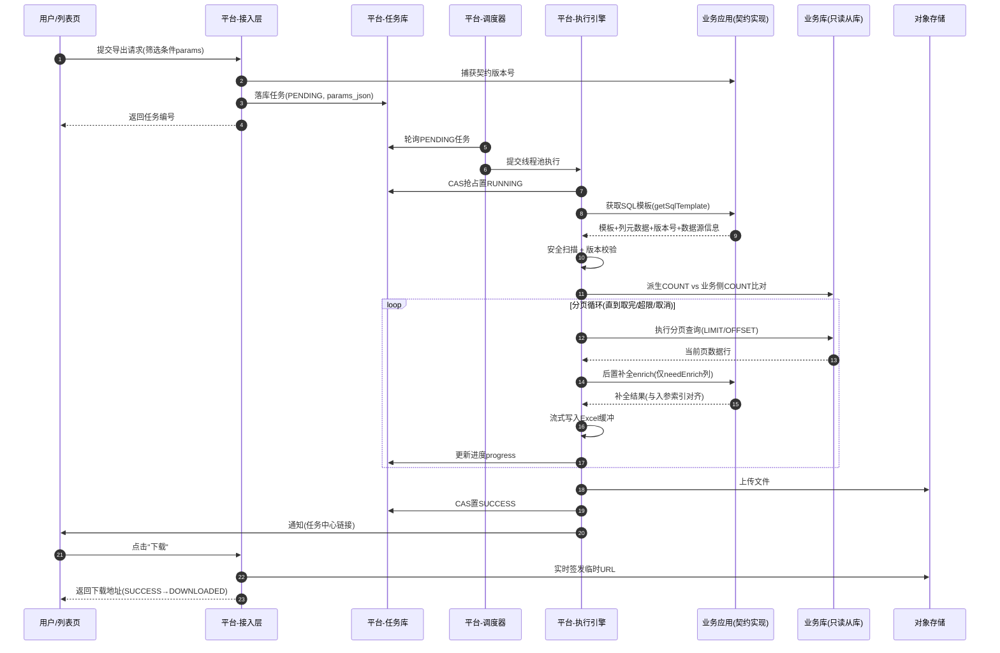
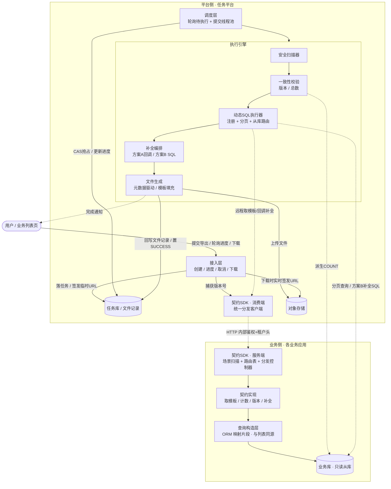
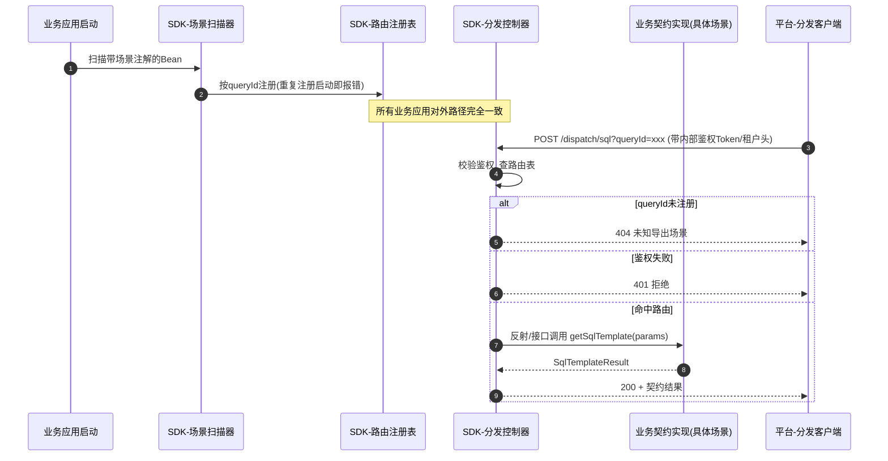
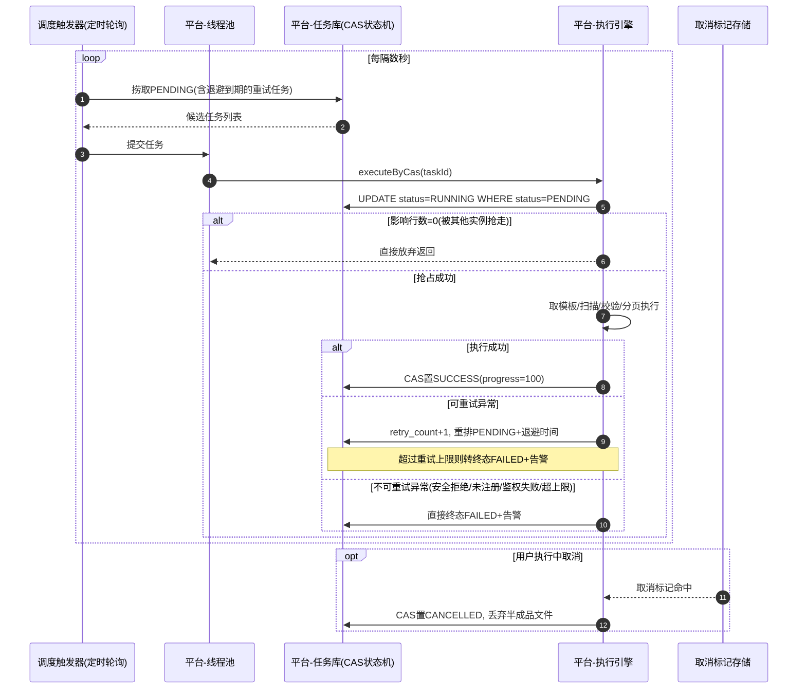
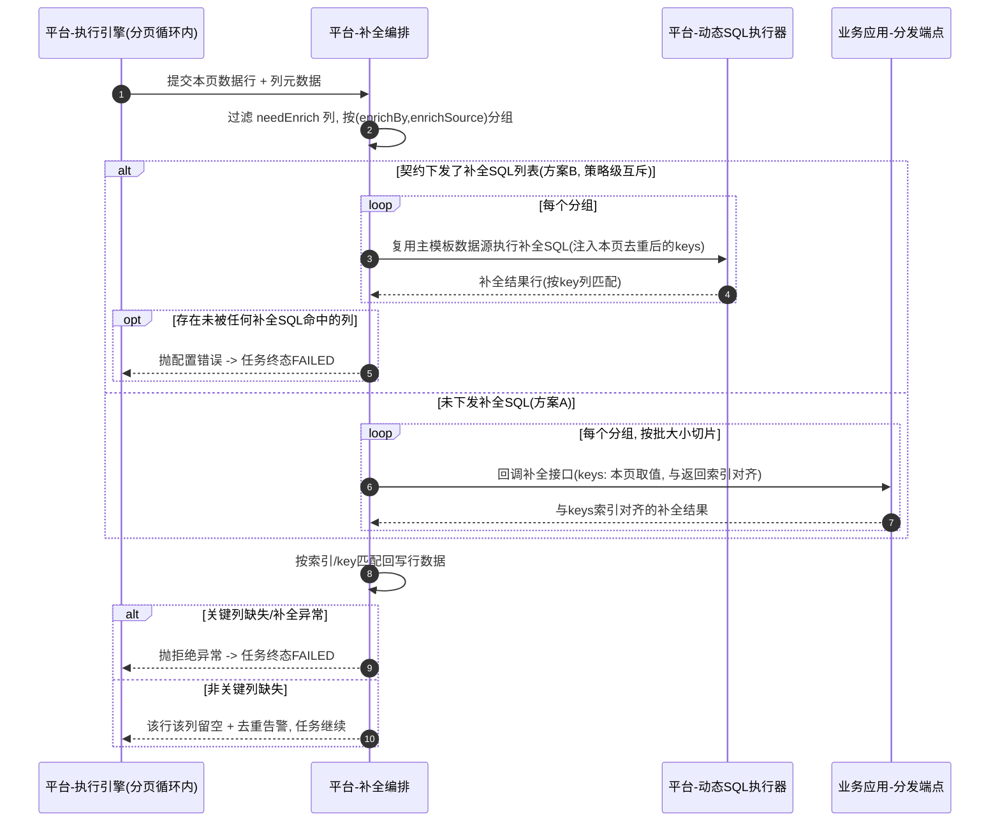

# SQL 下发 + 回调补全——统一导出任务下载的实现策略

> 本文分享一种"业务数据由业务侧管控、任务执行由平台统一收口"的架构思路，聚焦设计动机、关键机制与取舍。文中的类名、注解名均为示意命名，不对应任何具体工程源码；架构与流程通过时序图辅助说明，供正在建设"多业务系统统一导出/下载能力"的小伙伴参考。

---

## 1. 问题从哪来：N 个业务系统 × M 种导出需求

在有多个业务系统的平台里，导出/下载需求几乎每个系统、每个列表页都会提，而且高度相似：分页查询、动态筛选条件、大数据量、需要转成 Excel、需要异步执行和进度反馈。

如果每个业务系统各自实现一套，会出现几个问题：

1. **重复建设**：每个团队都要自己写一遍分页查询、异步任务表、Excel 生成、进度查询、文件存储、消息通知。
2. **体验不统一**：同一个用户在不同业务模块点导出，交互、进度反馈、失败提示各不相同。
3. **能力难以治理**：大查询拖垮数据库、导出无上限、超时/重试策略不一致，没有统一的并发控制和限流入口。
4. **性能风险散落在各处**：比如某个导出全量拉取内存导致 OOM，或者长事务锁表，排查成本高。

于是很自然地想到：能不能有一个**统一的导出任务平台**，所有业务系统只需要"提供数据"，剩下的"怎么查、怎么存、怎么生成文件、怎么通知用户"全部由平台托管？

但这里有一个绕不开的核心矛盾：

> **数据的筛选逻辑、权限口径、字段含义，天然只有业务系统自己最清楚；平台如果要把这些数据加工逻辑也接管，就等于要平台去理解每一个业务的查询语义——这几乎不可能维护。**

反过来，如果平台完全不碰数据加工逻辑，只提供任务队列 + 文件生成，那业务系统还是需要各自写查询代码，"统一"的价值就大打折扣。

我们的解法是：**平台不接管业务语义，只接管执行时机和交付流程**。具体手段就是本文标题里的两个词——**SQL 下发**和**回调补全**。

## 2. 核心思想：数据归属权不动，执行控制权上收

可以概括为一句话：

> **业务侧继续拥有"数据长什么样"的决定权（SQL、字段含义、权限口径），平台侧拿走"什么时候、以什么方式、用什么资源去执行"的调度权。**

落到具体机制上，就是一条清晰的分工线：

| 归属 | 职责 |
|------|------|
| 业务应用 | 提供与列表查询**同源**的 SQL 模板、可选的列表计数、契约版本号、非 SQL 字段的补全逻辑 |
| 任务平台 | 任务接入（创建/查询/取消/下载）、调度与并发控制、SQL 动态解析与安全执行（只读从库 + 分页）、补全流程编排、文件生成与存储、进度状态机与通知、一致性校验 |

业务侧不需要知道任务怎么排队、分页怎么切、文件存哪里、消息怎么发；平台侧也不需要理解每一条 SQL 的业务含义——只需要保证它能被**安全、可分页、可观测**地执行完，并把结果结构化地交付到用户手里。

这套分工的关键前提是：**SQL 必须由业务侧提供，并且要和业务侧的列表查询逻辑保持同源**。同源是后面所有一致性保障的地基（第 6 节展开）。

**图 1：端到端主流程时序总览**




**静态分层架构总览**

下面这张静态图是前述动态时序（图 1 及后续图 2～图 4）的整体总览：

- 左侧业务侧只暴露数据语义（契约实现 / 查询构造层 / 业务库）
- 右侧平台侧接管执行与交付（接入层 / 调度层 / 执行引擎 / 契约 SDK / 对象存储）

二者靠一份双向契约 SDK 连接。节点与连线均为示意命名，用于方便理解。




> 读图要点：**模板元数据（结构）走 SDK 远程回调获取，实际 SQL 执行由平台直连业务从库完成**；业务侧只在两处出场——提供同源模板/补全逻辑（SDK 回调链）与被查询的业务库，其余调度、并发、安全、文件、通知全部在平台侧闭环。

## 3. 契约先行：一份双向 SDK 把两侧连接起来

平台侧和业务侧的连接靠一份**双向契约 SDK**：同一个模块同时被业务应用（Provider）和任务平台（Consumer）依赖，通过配置开关区分角色——业务应用默认启用服务端能力，平台显式关闭，只用接口定义与客户端调用能力。这样契约的字段、语义只在一处定义，天然避免两侧各写一份导致漂移。

### 3.1 契约接口：业务侧只需要实现这一个 SPI

```java
public interface ExportContract {
    /** 获取与列表查询同源的导出 SQL 模板 */
    SqlTemplateResult getSqlTemplate(Map<String, Object> params);

    /** 列表查询总数（用于一致性交叉校验，可选） */
    default long countForList(Map<String, Object> params) { return 0L; }

    /** 当前查询契约版本号（用于陈旧性检测，可选） */
    default int getVersion() { return 0; }

    /** 后置补全非 SQL 字段，可选 */
    default List<Map<String, Object>> enrich(EnrichRequest req) { return Collections.emptyList(); }
}
```

这里有一个刻意的设计取舍：**入参用 `Map<String, Object>` 而不是强类型**。原因是跨应用无法约定一个统一 DTO（不同业务系统的筛选字段完全不同），强类型反而会把契约绑死。业务侧拿到 `Map` 后在自己的实现里转成强类型查询对象交给内部的查询构造器，平台侧完全不关心这个转换过程。

`getSqlTemplate` 的返回结果（示意命名 `SqlTemplateResult`）是整个契约里信息量最大的结构：

```java
public class SqlTemplateResult {
    private String sqlTemplate;              // 动态 SQL 片段（含 #{} 占位符）
    private List<ColumnDef> columns;         // 列元数据，驱动 Excel 表头/顺序/格式
    private String orderBy;                   // 排序字段
    private String tenant;                    // 多租户上下文
    private String schema;                     // 业务库名（跨库场景）
    private int version;                       // 契约版本号
    private TemplateType templateType;         // 文件生成模式：元数据驱动 / Excel模板填充
    private byte[] excelTemplate;              // Excel 模板字节（模板填充模式下必填）
    private ParamSchema paramSchema;            // 参数结构自描述
    private boolean supportCountForList;        // 是否参与总数校验
    private boolean supportVersion;             // 是否参与版本校验
    private boolean needEnrich;                 // 是否需要后置补全
    private List<EnrichSqlDef> enrichSqls;      // SQL 补全定义（方案 B）
}
```

几个值得注意的点：

- **不携带绑定参数值**。SQL模板里的 `#{}` 占位符，其绑定值统一来源于任务实例持久化的参数快照（用户提交导出时携带的筛选条件），而不是业务侧在返回里"顺手"塞一份参数值。这是一个刻意的**单一真相源（Single Source of Truth）**设计：如果业务侧可以额外塞参数，平台侧就会不知道某个 `#{}` 到底该从哪取值，最终导致绑定不一致或漏绑定。
- **三个 `supportXxx` 能力开关**。并非所有业务场景都需要做总数校验、版本校验、补全——比如一个没有派生字段的小表导出，实现补全逻辑就是多余的。这三个标记允许业务侧按需"声明能力"，平台侧据此决定是否调用对应方法，避免强制所有业务实现全部接口。

> 因为我们的项目使用Mybatis作为数据库的ORM框架，所有的业务sql都维护在xml中，通过mybatis的语法进行实现，因此我们这里实现的sql模板即为完全支持Mybatis语法的sql片段

### 3.2 场景注册与路由：业务侧零 HTTP 代码

早期设计里，每个业务应用要自己暴露一组 HTTP 接口（获取模板/计数/版本/补全 四个端点）给平台调用，这样每个业务方都要写一遍 Controller、配置一遍路径，容易出错且不统一。

现在的做法是 SDK 内置了一个自动注册的**分发控制器**：业务侧只需要给自己的契约实现类打上一个场景注解（示意：`@Scenario(queryId = "...")`）并声明为 Spring Bean。SDK 在应用启动时扫描所有带该注解的 Bean，按 `queryId` 注册进一个进程内的路由表，并由分发控制器统一暴露 4 个端点：

```java
@RestController
@RequestMapping("/dispatch")
public class ContractDispatchController {
    private final ContractRegistry registry;

    @PostMapping("/sql")
    public SqlTemplateResult getSqlTemplate(@RequestParam String queryId, @RequestBody Map<String, Object> params) {
        return require(queryId).getSqlTemplate(params);
    }
    // /count、/version、/enrich 同理，均为按 queryId 查路由表后转发调用

    private ExportContract require(String queryId) {
        ExportContract contract = registry.get(queryId);
        if (contract == null) {
            throw new NotFoundException("未知导出场景: " + queryId);
        }
        return contract;
    }
}
```

**图 2：契约注册与远程调用路由时序**




这样带来的直接收益是：**所有业务应用暴露给平台的接口路径完全一致**（只有服务名不同），平台侧的调用客户端只需要一个统一实现，按业务应用做服务发现即可，不用为每个业务应用配置不同的接口地址。

同时错误契约也被规范化：场景未注册返回 404（任务直接终态失败，不可重试）、鉴权失败返回 401（终态 + 安全告警）、业务实现抛异常返回 500（可重试）。平台侧据此做分类处置，不用靠解析异常堆栈猜错误类型。

## 4. SQL 模板下发与动态执行引擎

这是整个方案里技术含量最高、也是最"平台化"的部分：平台拿到的是一段**自己从未见过的动态 SQL 片段**，要能在自己的进程里正确、安全地执行，还要支持分页。


### 4.1 为什么用动态 SQL 片段而不是裸 SQL

业务列表查询往往包含大量条件分支（某些筛选条件为空时对应的查询片段整段不生效）。如果下发的是渲染后的裸 SQL，就意味着"动态条件在业务侧被冻结成一次性的固定值"，一旦筛选条件变化，SQL 结构就变了，平台没法复用同一份模板做分页绑定。而下发带占位符和条件标签的动态模板（本文以 MyBatis 风格的 `<script>` 片段为例），可以完整保留动态条件结构，平台侧只需要在**执行时**用真实参数渲染成 `?` 占位的 SQL。

### 4.2 动态注册：把陌生模板变成可执行语句

平台侧的核心做法是把收到的模板文本在运行时注册为一个可执行的语句对象（示意：动态注册一个 `MappedStatement`），复用成熟 ORM 框架已有的模板解析能力：

```java
private synchronized void registerIfAbsent(String statementId, String script) {
    if (registeredStatements.contains(statementId)) {
        return;
    }
    SqlSource sqlSource = driver.createSqlSource(configuration, script, Map.class);
    MappedStatement ms = new MappedStatement.Builder(
            configuration, statementId, sqlSource, SqlCommandType.SELECT)
            .statementType(StatementType.PREPARED)
            .resultMaps(singleResultMap(HashMap.class))
            .build();
    configuration.addMappedStatement(ms);
    registeredStatements.add(statementId);
}
```

几个细节值得一提：

- **语句 ID 必须带版本号**。因为注册表通常不支持删除已注册的语句，如果契约升级换了模板但沿用旧的 ID，会命中缓存里的旧 SQL 片段，导致"代码已经改了，导出的还是老逻辑"这种很难排查的问题。所以版本升级必须换新 ID，旧的直接废弃。
- **并发注册用"判重 + 加锁"防护**，避免同一模板被多个线程同时注册产生冲突。
- 注册目的仅仅是复用模板解析能力（动态标签 → 占位符 SQL + 参数映射），结果映射由通用的 `Map` 结构直接承担，不需要业务侧的实体类参与。

### 4.3 分页执行：子查询包裹 + 外置排序 + 绑定分页参数

```java
public List<Map<String, Object>> pageQuery(String statementId, Map<String, Object> params,
                                            String orderBy, long offset, int pageSize) {
    BoundSql bound = mappedStatement.getSqlSource().getBoundSql(params);
    StringBuilder sql = new StringBuilder("SELECT * FROM (").append(bound.getSql()).append(") _t");
    if (isNotBlank(orderBy)) {
        sql.append(" ORDER BY ").append(orderBy);  // orderBy 已通过白名单校验，见 4.5
    }
    sql.append(" LIMIT ? OFFSET ?");

    List<Object> values = bindValuesByParameterMappings(bound, params); // 全程 ? 绑定
    values.add(pageSize);
    values.add(offset);
    return routedJdbcTemplate.queryForList(sql.toString(), values.toArray());
}
```

要点：

1. **子查询包裹**是为了规避原始 SQL 里可能包含联合查询、分组查询时，直接追加分页子句产生的语义歧义。
2. **排序放在外层**，而不是信任原始 SQL 内部的排序，保证分页翻页时排序稳定，不会因为数据库优化器的执行计划差异导致翻页漏行/重复行。
3. **分页参数用占位符绑定**，不用框架自带的内存分页能力（先取全量结果再按偏移量截取）——后者在大数据量下内存会直接撑爆，是明确废弃的路径。至于为什么这里用 `OFFSET` 而不是业界常说的游标分页，是一个受场景约束的取舍，详见 10.3。
4. 排序列名不能走预编译占位符（属于 SQL 结构而非值），必须经过白名单校验才能进入字符串拼接路径（见 4.5）。

### 4.4 数据源与库名路由：解决"表找不到"的问题

业务 SQL 通常不带库名，依赖业务应用自己的默认连接配置。平台直接在自己的连接里执行必然会失败。

一种朴素的做法是平台侧为每一个业务库单独注册一个数据源，按业务下发的数据源标识路由；但在已有成熟读写分离基础设施的工程里，更常见的落地是简化为：**固定复用从库连接 + 执行前显式切换到目标库**：

> 说明：这个固定走从库的实现主要是基于我们现有的项目背景来的，因为我们没有强一致性的要求，所以直接使用从库连接即可（当然也可以使用更灵活的主从库自主选择方案）

```java
private void applySchema(Connection conn, String schema) {
    if (isBlank(schema)) {
        return;
    }
    if (!schema.matches("[A-Za-z0-9_$]+")) {
        throw new RejectException("非法 schema 名称: " + schema);
    }
    try (Statement st = conn.createStatement()) {
        st.execute("USE " + schema);
    }
}
```

即：**导出执行固定走从库**（避免影响业务主库的写入性能），跨库场景由契约下发目标库名，执行前显式切换，并且对库名做白名单正则校验防止拼接注入。切换动作在每次执行前显式做一次即可，连接归还后不需要额外复位，避免线程池复用导致"串库"。

落地过程中还踩过一个很实际的坑：通用结果集映射成 `Map` 时，日期/时间列可能命中某些老旧数据库驱动不支持的取值方法重载，直接抛异常。解决办法是注册一个自定义的类型处理器，统一走驱动原生支持的取值方式，并对多种类型解析路径分别兜底——这类细节大概率会在真实场景测试时会遇到的，作为也给踩坑的过来人建议是提前预留类型处理器。

### 4.5 安全扫描：设计与落地的取舍

最初的设计定的是"**模板全面禁止任何字符串拼接型占位符**"（例如 `${}` 风格），因为这类占位符在模板解析阶段就已经完成字符串替换，等参数绑定阶段再扫描为时已晚，是注入攻击的高风险点。

实际落地时发现这条"一刀切"规则行不通：业务侧的行级数据权限片段、静态枚举常量等，往往由业务框架自身生成并以拼接型占位符引入模板，这些片段来源可信，但如果被全面禁止，业务侧就要把所有权限逻辑重新改写，成本极高且不现实。于是最终的扫描策略调整为：

```java
public static void check(String templateText, String orderBy, Set<String> allowedOrderFields,
                          Set<String> allowedQueryIds, String queryId) {
    String cleaned = stripComments(templateText);
    // 1) 不再全面禁止拼接型占位符：模板由业务侧从已审核的可信片段生成，非用户输入
    // 2) 危险语句/多语句兜底拦截
    if (FORBIDDEN_PATTERN.matcher(cleaned).find()) {
        throw new RejectException("SQL 模板包含禁止的操作类型");
    }
    // 3) 场景白名单：仅允许配置中启用的场景被执行
    if (!allowedQueryIds.contains(queryId)) {
        throw new RejectException("场景未启用: " + queryId);
    }
    // 4) 排序字段白名单
    for (String segment : splitOrderBy(orderBy)) {
        if (!allowedOrderFields.contains(segment)) {
            throw new RejectException("排序字段不在白名单: " + segment);
        }
    }
}
```

即放弃"语法级禁止"，改为**语义级兜底拦截**（DDL/DML 关键词、加锁查询、导出文件写入等危险操作类型）+ **来源可信约束**（模板由业务侧从自己已经代码审核过的查询片段生成，而不是用户输入直接拼接）+ **场景白名单**（只允许配置中启用的场景被执行）三层组合。这是一个比较典型的"设计追求理论最优，落地选择风险可控且成本可接受"的取舍例子。

## 5. 任务生命周期与统一调度

作为统一的任务下载中心，我们需要对任务的全生命周期进行负责，所以我们需要有一套明确的、清晰的任务定义与驱动条件定义

### 5.1 任务状态机

任务状态通常包含：

- 待执行（`PENDING`）
- 执行中（`RUNNING`）
- 生成完成未下载（`SUCCESS`）
- 已下载（`DOWNLOADED`）
- 失败（`FAILED`）
- 数据不一致（`INCONSISTENT`）
- 版本已过期（`STALE`）
- 已取消（`CANCELLED`）。

### 5.2 执行主流程

任务执行引擎的编排逻辑可以抽象成"抢占 → 取模板 → 扫描校验 → 一致性校验 → 分页循环 → 收尾"：

```java
public void executeByCas(Long taskId) {
    if (taskMapper.markRunning(taskId) == 0) {
        return; // CAS 抢占失败，说明已被其他线程/实例捞走
    }
    try {
        doExecute(taskId);
    } catch (Throwable t) {
        // 兜底：无论内部以何种方式退出，任务都要脱离 RUNNING，不能永久卡死
        handleFailure(taskId, t);
    }
}

private void execute(Task task) {
    Map<String, Object> params = parseParams(task.getParamsJson());
    SqlTemplateResult result = contractClient.getSqlTemplate(task.getBizApp(), task.getQueryId(), params);

    SqlSafetyScanner.check(result.getSqlTemplate(), result.getOrderBy(),
            orderFieldsFromColumns(result), enabledQueryIds(), task.getQueryId());

    if (result.isSupportVersion() && result.getVersion() != task.getContractVersion()) {
        taskMapper.markStale(task.getId(), "查询逻辑已升级，请重新导出");
        return;
    }

    long total = consistencyService.verifyTotalAndLimit(task, result, params);
    if (total < 0) {
        return; // 校验失败，已落终态
    }

    FileContext ctx = fileService.open(task, result);
    long offset = 0, processed = 0;
    while (true) {
        if (cancelFlagSet(task.getTaskNo())) {
            return cancelTask(task, ctx);
        }
        List<Map<String, Object>> rows = sqlExecutor.pageQuery(result, params, offset, pageSize);
        if (rows.isEmpty()) {
            break;
        }
        enrichService.enrich(task, result, rows);
        if (cancelFlagSet(task.getTaskNo())) {
            return cancelTask(task, ctx); // 写盘前二次检查，避免脏数据落盘
        }
        fileService.write(ctx, rows);
        processed += rows.size();
        taskMapper.updateProgress(task.getId(), processed, percent(processed, total));
        if (rows.size() < pageSize) {
            break;
        }
        offset += rows.size();
    }
    fileService.closeAndUpload(ctx, task);
    taskMapper.markSuccess(task.getId(), processed);
    notifyService.notify(task);
}
```

几个设计要点：

- **调度抢占用纯数据库 CAS，不用分布式锁**。抢占动作本质是一条带状态条件的更新语句（`UPDATE ... WHERE status='PENDING'`），影响行数为 0 说明这个任务已经被别的线程/实例抢走，直接放弃即可。这样避免了引入分布式锁的复杂度（锁续期、锁丢失）和单点风险，代价是多实例部署时会有少量"无效捞取"（捞到任务但 CAS 失败），可以接受。"轮询 + CAS"与"消息驱动"两种触发路线的进一步对比，见 10.4。
- **流式执行是唯一实现**，没有"全量内存模式"。每一页都是"查询 → 补全 → 写文件"的固定节拍，内存里只保留当前页数据，写完即释放引用，保证内存占用可控。
- **取消检查在每页前后各做一次**：查询前检查一次避免白做，写盘前再检查一次避免"本页数据已经补全和写盘了，用户才点取消"造成的脏数据落盘。取消信号一般通过外部存储的标记位（如缓存 key）传递，不额外占用数据库连接。
- **重试策略分层**：可重试异常（比如远程调用超时、业务侧临时故障）走退避重排（有限次数，间隔指数增长）；不可重试异常（安全扫描拒绝、场景未注册、鉴权失败、超行数上限）直接终态失败 + 告警。外层再包一层兜底捕获，保证即使主流程没有正常收敛，任务也不会永久卡在"执行中"状态。

**图 3：任务调度与执行时序（含并发抢占、重试、取消）**




## 6. 一致性保障：四层防线

导出最怕的问题是"导出的数据和用户在列表页看到的不一致"，用户会直接质疑数据准确性，这类问题往往比导出失败更难被谅解。为此设计了四层防线：

| 层级 | 机制 | 保障点 |
|------|------|--------|
| 第一层 | SQL 同源（架构约束） | 业务侧的模板获取逻辑必须复用列表查询本身的查询构造器/映射片段 |
| 第二层 | 版本号校验 | 任务创建时记录契约版本，执行时比对，不一致标记终态"版本过期" |
| 第三层 | 总数校验 | 平台侧派生的导出总数 vs 业务侧提供的列表总数，不一致标记"数据不一致" |
| 第四层 | 契约测试 | 业务应用在自身 CI 用 SDK 提供的测试工具断言列一致性、总数一致性、补全字段完整性 |


第一层是架构层面的约束（无法用代码强制，靠契约 SDK 提供工具降低维护成本）；第二、三、四层分别有对应实现。这套四层防线本质是**乐观的事后检测**策略——先假定导出期间数据不变，跑完再用版本号、总数去验算是否成立；与之相对的"事前锁定一致性快照"路线，取舍见 10.5。第三层的核心逻辑：

```java
long exportTotal = sqlExecutor.countDeriveFromTemplate(result, params); // SELECT COUNT(*) FROM (模板) _t
long listTotal = contractClient.countForList(bizApp, queryId, params);

if (exportTotal != listTotal) {
    sleep(backoffMs); // 主从延迟容错：退避重查一次
    exportTotal = sqlExecutor.countDeriveFromTemplate(result, params);
    listTotal = contractClient.countForList(bizApp, queryId, params);
}
if (exportTotal != listTotal) {
    if (consistencyStrict) {
        taskMapper.markInconsistent(taskId, "导出总数与列表总数不一致"); // 严格模式：终态阻断
        alertService.send("导出与列表不一致", taskNo, detail);
        return -1;
    }
    alertService.send("导出与列表不一致(降级放行)", taskNo, detail); // 灰度模式：仅告警不阻断
}
if (exportTotal > maxRows) {
    throw new RejectException("超出单次导出上限"); // 上限拦截，不进入分页
}
```

派生总数所用的 SQL（对外层包裹后的模板取 `COUNT`）与分页查询走同一套绑定路径、同一数据源，最大化保证"平台数出来的行数"和"业务列表页数出来的行数"是同一个口径。同时保留了严格/降级开关——读写分离架构下主从同步延迟本身可能造成偶发的计数不一致，一刀切阻断会影响可用性，因此设计成"默认严格、灰度期可降级为仅告警放行"。

## 7. 后置补全：SQL 覆盖不了的字段怎么补

有些列无法在主查询 SQL 里直接查出：比如需要调用外部接口计算得到的评分、需要按某个字段的层级结构拆分派生的名称、跨库才能关联到的字典等。这类列在列元数据上标记"需要补全"，由平台在执行流程中**按需回调业务侧**补全。

平台提供了两种互斥的实现路径：

**方案 A：回调补全**——业务侧在契约实现里编写补全逻辑（调接口 / 二次查库 / 内存计算均可）：

```java
@Override
public List<Map<String, Object>> enrich(EnrichRequest req) {
    List<?> keys = req.getKeys(); // 平台按当前页该列取值去重后传入
    Map<Object, Raw> byKey = loadRawData(keys); // 例如按主键批量回查
    List<Map<String, Object>> result = new ArrayList<>(keys.size());
    for (Object key : keys) {
        Raw raw = byKey.get(key);
        Map<String, Object> extra = new HashMap<>();
        extra.put("derivedFieldA", computeA(raw)); // 派生字段计算逻辑归业务侧自己维护
        extra.put("derivedFieldB", computeB(raw));
        result.add(extra);
    }
    return result; // 必须与入参 keys 严格按索引一一对齐
}
```

这里有一个容易忽略的契约细节：**返回结果必须与入参列表严格按索引一一对齐**。如果业务实现底层用了不保证返回顺序的查询方式（比如 `IN` 列表查询），需要在自己侧按入参顺序回排，否则平台按下标回写结果时会把前一行的补全值写到后一行上——这是一个典型的"接口签名对，语义约定错"的隐蔽 bug。

**方案 B：SQL 补全**——业务侧在下发主模板时，一并下发一段"按主键/编码回查关联表"的独立 SELECT 片段，平台直接复用主查询已经路由好的数据源执行，省去一次网络往返，天然规避分页 × 补全的 N+1 问题。

两种方案在同一个任务内**策略级互斥**，不能混用：只要下发了方案 B 的补全 SQL，整个任务就只走 B，此时所有标记"需要补全"的列必须命中某一段补全 SQL 的分组定义，否则按配置错误直接终态失败，避免"静默漏补"这种更隐蔽的问题；没有下发补全 SQL 时，整个任务只走方案 A 的远程回调。

补全失败的降级策略也做了分级：

- 标记为"关键列"的字段补全失败 → 任务终态失败（业务明确声明"这列必须有值"）；
- 未标记为关键列（默认）的字段补全失败 → 该行该列留空 + 一次告警，任务继续执行。

这样把"要不要因为这一列拿不到值而让整个导出失败"的决定权，交回给最了解业务含义的业务侧（在列定义上声明是否关键），平台只负责按声明执行既定策略就行了。

**图 4：后置补全两方案决策与执行时序**




## 8. 文件生成：两种模式，从"元数据驱动"到"Excel 模板填充"

平台侧的最终交付物是用户拿到的表格文件。跨应用传递的行数据（通用键值结构）本身不携带任何"展示语义"（表头文字、列顺序、日期/数字格式、列宽），这些语义通过列元数据契约传递，由 SDK 从业务侧已有的实体注解反射提取，保证业务侧不需要手写第二遍列定义。


文件写入采用三段式流式接口（打开 → 按页写入 → 收尾并上传）：

```java
public FileContext open(Task task, List<ColumnDef> columns, SqlTemplateResult result) {
    if (result.getTemplateType() == TemplateType.EXCEL_TEMPLATE) {
        // 模板填充模式：以下发的表格模板字节为写入模板，按占位符名填充
        ctx.writer = excelWriter.withTemplate(new ByteArrayInputStream(result.getExcelTemplate())).build();
        ctx.writer.fill(buildSummaryRow(task), ctx.sheet); // 汇总区单值占位符先填
    } else {
        // 元数据驱动模式（默认）：按列元数据构建动态表头
        ctx.writer = excelWriter.build();
        ctx.sheet = writerSheet(buildHead(columns));
    }
    return ctx;
}

public void write(FileContext ctx, List<Map<String, Object>> rows) {
    if (ctx.templateMode) {
        rows.stream().map(row -> toFillRow(row, ctx.columns)).forEach(ctx.bufferedDetailRows::add);
    } else {
        ctx.writer.write(convertRows(rows, ctx.columns), ctx.sheet); // 按列类型/格式转换单元格
    }
}
```

**模板填充模式**解决的问题是：部分业务场景的导出文件不是简单的"表头 + 明细行"结构，而是带有固定排版格式的报表（顶部有汇总区、标题栏、多段明细区），纯列元数据无法描述这种版式。该模式允许业务侧直接复用现成的表格模板文件（模板里用占位符标记待填字段），平台只负责按字段名填充值，把"格式设计"的工作彻底交回给业务侧，平台专注数据填充。两种模式对上层任务流程完全透明，均由契约在返回模板信息时声明具体模式，平台按声明切换写入策略。

收尾阶段：文件写完后上传对象存储（路径按日期 + 任务编号组织），落文件记录表；下载接口在用户点击时**实时签发**临时签名地址（有有效期），而不是在生成文件时固化一个长效地址——避免签名地址过期或者被转发带来的安全风险。

## 9. 设计落地过程中的关键取舍复盘

回顾整个过程，有几处"设计初衷"和"最终落地"不一致的地方，值得单独复盘，因为这类取舍往往是这类平台化项目最难把握、也最有分享价值的部分：

| 设计初衷 | 落地调整 | 原因 |
|----------|----------|------|
| 按数据源标识动态注册每个业务库的独立数据源 | 复用现有读写分离基础设施，固定走从库连接 + 执行前切换目标库 | 已有成熟的多数据源基础设施，重新实现一套动态注册成本高且重复；库名兜底切换足够覆盖跨库导出场景 |
| 模板全面禁止字符串拼接型占位符 | 允许来源可信的拼接型片段（如数据权限片段），改为危险语句关键词兜底拦截 | 业务侧行级权限逻辑大量依赖框架生成的可信片段，全面禁止会导致业务侧改造成本不可控，风险改由"来源可信 + 危险语句兜底"共同覆盖 |
| 列元数据（即DTO中的注解方案）驱动生成文件（单一模式） | 新增表格模板填充模式（双模式） | 部分业务报表有固定版式（汇总区 + 多段明细区），元数据驱动无法描述，新增模板下发路径，业务侧几乎零改造成本复用现有表格设计 |
| 强制业务实现总数校验/版本校验/补全 | 新增能力声明开关，业务侧可按需省略实现 | 并非所有场景都需要这些能力，强制实现会加重简单场景的接入成本 |

这些调整的共同逻辑是：**契约的"能力"要完整，但契约的"义务"要按需**。平台提供的能力清单是全量的，但每个业务接入方只需要为其真实需要的能力买单，其余能力通过声明式开关跳过，这是这套 SDK 化契约能够被多个业务系统低成本接入的关键。


## 10. 横向对比：其他可选技术路线

前九节聚焦"这套方案本身怎么落地"，这一节把视角拉高，对比"统一导出/下载"这个命题下业界常见的另外几条技术路线，说明本文方案是在哪些约束下做出的选择，而不是唯一解。


### 10.1 数据获取路径：配置化直连 / 下发动态 SQL / 分页拉取业务 API

平台介入业务数据的深度，本质上是一条从浅到深的谱系：

| 路径 | 做法 | 优势 | 代价 |
|------|------|------|------|
| 平台配置化直连 | SQL 静态写在平台配置表 / 管理后台，平台持有业务库连接池直接执行 | 不依赖业务应用在线，链路最短 | SQL 静态写死，丢失动态条件同源能力；权限口径需在平台侧另行维护，容易与业务列表页脱节 |
| 下发动态 SQL（本文方案） | 业务运行时生成动态模板下发给平台，平台直连业务从库执行 | 动态条件完整保留，与列表同源可验证 | 依赖业务应用在线提供模板；平台需要能连通业务从库 |
| 分页拉取业务 API | 平台完全不碰 SQL，只调用业务已有的分页列表接口逐页取数 | 业务侧接入成本最低（已有列表接口即可） | 分页一致性最难保证（两次调用间数据可能变化，比版本号校验更难兜底）；列表接口通常附带计数、权限校验等额外开销，深分页性能不可控；平台完全无法感知底层查询逻辑 |

三者取舍的核心问题是"**同源保证到什么程度**"：如果要求导出结果与列表页严格可验证地一致，配置化直连和 API 拉取都会引入额外的一致性维护成本，下发动态 SQL 是在这条要求下综合成本最低的选择；如果本身对"导出与列表是否逐行一致"没有强诉求（比如只是给下游系统灌数据），配置化直连或 API 拉取反而更轻量。

当然我们这里不适用`第三种分页拉去业务API`这个方案还有个一个非常关键的原因，需求方要求将执行逻辑从业务端迁移到任务中心，减少导出场景对业务系统本身的资源占用（CPU/内存）😂

### 10.2 执行引擎位置：在线从库分页 vs 预计算宽表 / OLAP 引擎

本文方案假设"导出必须实时反映当前数据、且查询复杂度可控"，因此选择直接在业务从库上分页执行。当单场景数据量或聚合复杂度超出这个假设时，业界另外两条路线是：

- **预计算宽表 / 物化视图**：把高频导出的多表关联、聚合结果提前抽取到一张专用宽表，导出退化为"扫一张扁平表"，不再在导出请求触发时做关联查询。牺牲实时性（通常是延迟刷新），换取查询耗时和稳定性可预测，且天然与在线交易库解耦。
- **OLAP 引擎分流**：把报表/导出类查询整体迁到列式分析引擎执行，在线交易库只承担实时业务读写。适合千万行以上、聚合复杂的场景，代价是引入一套独立的数据同步链路和运维体系。

**与本文方案的关系**：这两条路线并非替代关系，而是"数据源路由"这一层可以插拔的下一档——只要契约下发的数据源标识从"业务从库"切换为"宽表 / OLAP 集群"，上层的模板获取、补全、流式写入、状态机流程都不需要改动。这也是分层设计的价值所在：**执行引擎和数据源解耦之后，扩容查询能力不需要重新设计任务框架**。

### 10.3 分页算法：OFFSET 分页 vs 游标（Keyset）分页

这是本文方案与业界通用建议最接近"反直觉"的一处选择。多数数据库最佳实践资料会建议：**深翻页场景应优先用游标分页替代 OFFSET 分页**——OFFSET 需要数据库扫描并丢弃偏移量之前的所有行，翻页越深扫描代价越高；游标分页用上一页末行的排序键值作为下一页的过滤条件（`WHERE sort_key > ?`），走索引定位，性能基本恒定。

本文方案仍然用 OFFSET，原因是：

1. 游标分页要求排序键唯一且可预期（通常是主键或主键兜底的复合键），而这里的排序字段是业务侧动态下发、经白名单校验的任意展示列，不保证唯一，也不保证有对应索引；
2. 分页是对"外层包裹的子查询"做的，平台无法预知内层哪一列适合作为游标锚点，也无法保证游标条件在业务库上有可用索引；
3. 导出场景的行数上限本身受 `maxRows` 约束，"深翻页"的绝对次数有限，OFFSET 性能退化在此量级下通常不构成瓶颈。

这是一个"**用可预期的场景约束（限流上限）替代更优但更复杂的算法**"的取舍。如果未来开放不限行数的超大规模导出，这一节的选择需要重新评估——届时更合理的演进方向不是把 OFFSET 换成游标分页，而是先走 10.2 的分流路线（宽表 / OLAP），因为那种量级下"实时查在线库分页"这个前提本身就不再成立。

### 10.4 调度触发：轮询数据库 + CAS vs 消息驱动

异步任务框架里，"任务创建后如何触发执行"有两条主流路线：

| 维度 | 轮询 DB + CAS 抢占（本文方案） | 消息驱动（创建即投递消息，消费端执行） |
|------|------|------|
| 触发延迟 | 最坏等到下一个轮询周期（秒级） | 近乎实时 |
| 削峰 / 背压 | 天然由轮询节奏 + 线程池容量控制 | 需要消费端手动确认 + 预取速率控制，配置更复杂 |
| 失败重试与状态 | 状态唯一存放在任务表，重排 / 退避逻辑集中在一处 | 消息重试队列 / 死信队列 + DB 状态两处维护，需要额外对账 |
| 悬挂恢复 | 定时扫描超时"执行中"任务即可兜底 | 消息丢失 / 重复消费需要幂等设计和补偿机制 |
| 组件依赖 | 只依赖数据库 | 额外引入消息中间件及其运维成本 |

对"导出"这类**延迟不敏感（分钟级可接受）、但对状态可靠性和重试可控性要求高**的场景，把状态真相收敛在数据库一处、用轮询节奏天然限流，通常比引入消息中间件"少一处可能不一致的地方"。这不是说消息驱动方案不可行——如果业务侧还有"任务优先级抢占""多租户公平调度"这类更复杂的调度诉求，纯轮询 + 数据库 CAS 的表达力就不够了，那时消息驱动配合优先级队列会是更合适的选型。

### 10.5 一致性策略：事后校验 vs 事前快照

本文的四层防线（同源 / 版本号 / 总数 / 契约测试）本质是**乐观的事后检测**：先假定导出期间数据不变，跑完后用版本号、总数去"验算"是否成立，不成立则终止或降级。另一条更彻底但更重的路线是**事前锁定一个一致性视图**：

- **数据库一致性读快照**：在支持多版本并发控制的数据库里，把整个分页循环放进同一个长事务（配合一致性快照隔离级别），后续所有分页查询天然看到同一时间点的数据，不需要跨页版本号校验。代价是长事务持有回滚段，在高并发写入的业务库上有主从延迟放大、事务膨胀的风险；并且很多数据库实现下，这种一致性快照只在单个连接内生效，与本文"每次分页独立借还连接、避免长期占用连接池"的设计初衷冲突。
- **导出前置快照 / 临时结果集**：更重的做法是先把查询结果固化成一份临时快照（物化成中间表或临时结果集），导出全程只读这份快照，彻底和数据变化解耦。代价是额外一次全量写入的存储与时间开销，接近"先物化再导出"，适合对一致性要求极高、但可接受更高延迟的合规类报表场景。

本文的"版本号 + 总数校验"是在**不引入长事务、不做数据物化**这两个约束下能做到的最优折中：版本号挡住"查询逻辑本身在导出期间被升级"，总数挡住"数据在导出期间发生增删"。理解这一层设计动机很关键——否则容易把版本号校验误读成一个可有可无的防呆字段，而意识不到它实际上在替代一个成本更高的方案。

### 10.6 文件生成链路与格式

本文的方案是"边查边写本地临时文件 → 收尾时一次性上传对象存储"，输出格式默认是表格文件（列元数据驱动 / 模板填充双模式，见第 8 节）。另外几条常见路线：

- **格式维度**：表格文件有单表行数上限，且解析开销大；当数据是给下游系统而非人工查看时，文本类分隔符格式或列式文件格式是更常见的选择。
- **直传对象存储**：把"写本地临时文件再上传"换成"边分页边分片上传对象存储"（分段上传机制），可以省掉本地磁盘依赖，减少大文件收尾时的一次性网络传输峰值，代价是实现和错误恢复逻辑更复杂（需要管理分片状态）。
- **前端本地生成**：小数据量（通常几千行以内）场景可以完全不走后端任务系统，前端拉分页数据后在浏览器本地生成文件。这反过来界定了本文这套异步任务架构的**适用下限**——不是所有导出都需要一套任务平台，数据量小到浏览器能一次性处理的场景，引入完整的任务调度体系反而是过度设计。

### 10.7 小结：这是一张"约束对照表"，不是标准答案

把以上考虑点放在一起，可以看出本文方案的实际选择逻辑：

| 关键约束 | 本文选择 | 如果约束变化，更合适的路线 |
|----------|----------|----------------------------|
| 导出必须与列表实时同源、可验证 | 下发动态 SQL + 版本号/总数事后校验 | 若不强求同源实时，可用预计算宽表 / 快照表 |
| 数据量级受行数上限约束、可控 | 业务从库 OFFSET 分页 | 若放开到超大规模，应分流到 OLAP / 宽表，分页算法本身也要重新评估 |
| 状态可靠性和重试逻辑优先级高于触发延迟 | 轮询 DB + CAS | 若需要优先级/公平调度，消息驱动更合适 |
| 不能长期占用业务库连接 | 每次分页独立借还连接 + 版本号校验兜底一致性 | 若可接受长事务/连接占用成本，可用一致性快照替代版本号校验 |

这一节的目的不是论证"本文方案更优"，而是把"在什么约束下本文方案是最优解、在什么约束下应该换路线"讲清楚，通常这一章节的内容是在技术选型/评审阶段就需要做的，通过多个方案的对比，结合实际的业务场景，然后选择一个当下最优解。

## 11. 适用场景与局限

**适合这套架构的场景**：
- 多个业务系统有相似的导出需求，且业务侧本身已经有成熟的列表查询逻辑（查询构造层 / ORM 映射片段）可以复用；
- 对导出的数据准确性要求高，需要与列表查询保持同源可验证；
- 平台侧希望统一管控并发、限流、审计、告警，不希望这些能力散落在各业务系统。

**不太适合/需要额外评估的场景**：
- 业务侧本身没有结构化的查询构造层（例如查询逻辑散落在各处硬编码），同源改造成本会比较高；
- 数据量极大、需要跨库多表联合查询的复杂报表场景，单纯"下发一段 SQL"可能不足以覆盖，需要引入更重的数据处理层；
- 对导出实时性要求极高（秒级同步返回）的场景，异步任务模型本身就有延迟，这套方案更适合"分钟级异步 + 通知"的交互。


## 12. 小结

这套架构的核心，是用一份"SQL 契约 + 回调契约"把业务侧和平台侧的关注点切开：**业务侧保留对数据语义的最终解释权（SQL 同源、字段补全、表格模板），平台侧拿走对执行过程和交付体验的统一控制权（调度、执行、并发、状态机、文件、通知）**。四层一致性防线、能力声明式的契约设计、流式分页执行和纯数据库 CAS 调度这些具体机制，共同支撑起这个切分在工程上真正可行。

设计阶段的"理想态"在落地时做了几处针对性的取舍，这些取舍本身也是这套方案能够在我们的应用场景中落地的关键适配（换句话说，但凡说适配的场景，都是因为设计之初没有漏了考虑的地方🤭）
