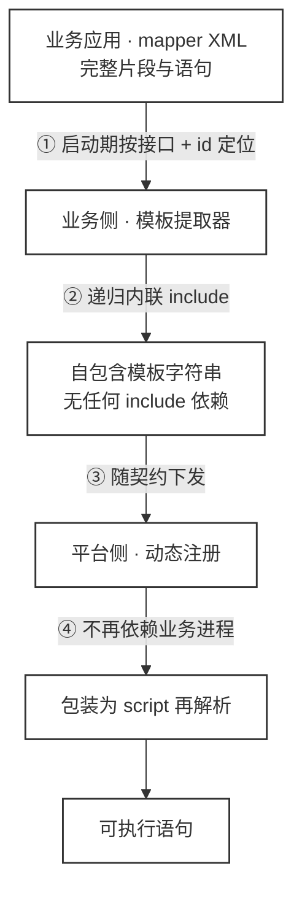
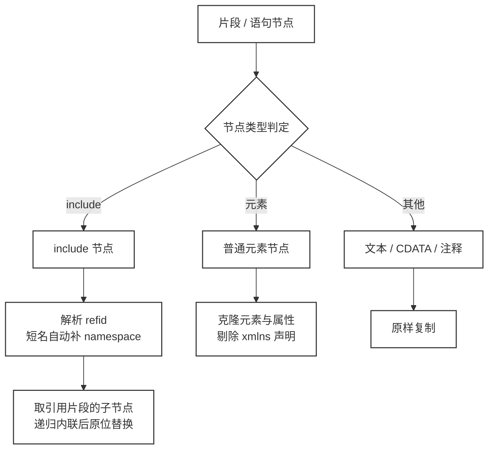
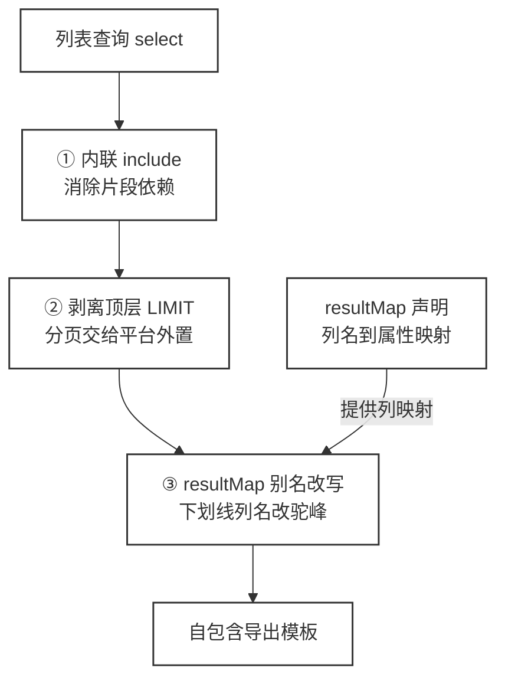
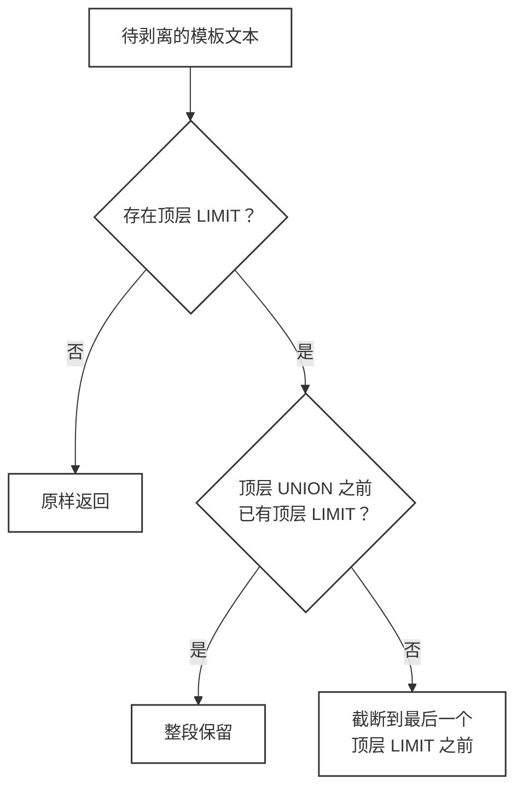
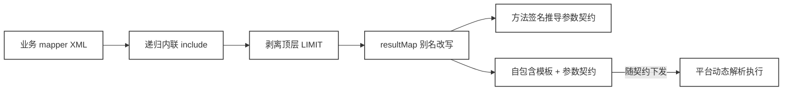

# 把 MyBatis XML 还原成自包含 SQL 模板（统一导出平台细节补全）


> 本文是《01.统一导出任务下载中心架构方案设计与实现》的细节补全篇。上一篇文章刻意略过了一个问题，业务侧下发的"与列表查询同源"的 SQL 模板，究竟是怎么从 mapper XML 里生成的。本文把它拆开，从设计动机讲到具体实现，再到关键的踩坑点。

---

上一篇文章把平台的主干流程讲完了，业务侧下发 SQL 模板，平台侧动态解析、分页执行、统一交付。

但有一个细节当时被刻意略过了，业务侧手里那段模板，到底是怎么从 mapper XML 里长出来的？

这个细节说小不小。提取这一步做不干净，平台侧的动态解析会在第一次导出任务上直接报错，而且是那种报错信息完全不指向根因的错误。我们把它做成了一个独立的小工具，本文从设计动机讲到实现，再把中间踩过的坑逐个摆出来。

读完这篇，大家能带走三样东西。一份"基于Mybatis的xml 业务SQL 还原为自包含 SQL 模板"的完整思路与实现，一套剥离业务分页的 SQL 文本处理手法，还有一张可以直接抄走的踩坑清单。

## 01、为什么要先做"模板提取"这一步？

先说结论，直接把 mapper XML 里的片段原文下发，平台侧是可能解析不了的。

原因藏在 MyBatis 的解析机制里。平台收到模板后，会把它包装成 script 脚本再用 XML 语言驱动解析，遇到 include 标签时要查当前进程的 Configuration 里有没有对应的 `<sql>` 片段。

业务应用进程里有这些片段，任务平台进程里没有。查不到，解析时就会抛 `IncompleteElementException`，任务直接失败。

先看模板在两个进程之间的流转路径。



模板一旦在业务侧完成内联，平台侧的解析就不再依赖任何业务进程的内部状态，这一步是后面所有能力的前提。

同一份 mapper XML，在两个进程里的"完整程度"不一样，这就是整个问题的根源。

有小伙伴可能会想，把业务应用的 mapper XML 也给平台加载一份不就行了。这条路走不通，第一，业务 XML 是全量文件，为一个导出场景把整套 mapper 拖给平台，体积和加载成本都不可控。

第二，两个进程各自持有 XML 副本，改一边忘一边，同源一致性就破了。

所以模板必须在业务侧完成内联，以完全自包含的形态下发。这也是提取器存在的唯一理由。

## 02、怎么从 MyBatis 手里拿回原始 XML？

这里有个反直觉的事实，语句对象里拿不回模板原文。

MyBatis 在启动时就把 XML 消化成了内部对象，动态标签被转换成节点树，include 要么被展开、要么被挂起等待补全。运行时从语句对象出发，只能拿到编译后的产物，拿不到带 include 标签的原始文本。

还有一条弯路要提前排除。直接拼接语句对象吐出来的 SQL 字符串行不通，那条路只能拿到静态骨架，动态 if 标签已经被拆成了判断节点，拼回去的文本和 XML 原文早就不是同一个东西。绕开的办法只有一个，回到 XML 原件。

好在留了两扇后门，片段和语句的拿法不一样。提取器入口先做分流。

```java
public String extract(Class<?> mapperInterface, String id) {
    String statementId = mapperInterface.getName() + "." + id;
    // <sql> 片段在 Configuration 里存着原始 XNode（DOM 节点）
    if (configuration.getSqlFragments().containsKey(statementId)) {
        return extractFragment(mapperInterface, id);
    }
    // <select> 等语句只记录了 resource 字符串，需要重新读 XML 解析
    return extractStatement(mapperInterface, id);
}
```

`<sql>` 片段走第一条路，直接操作 Configuration 里保留的原始 DOM，改起来最顺手。

select 语句走第二条路，根据语句对象记录的 resource 串把 mapper XML 重新读回来，手动解析一遍，再定位到目标节点。


重新解析这步有个很容易撞上的坑。mapper XML 头部声明了外部 DTD，JVM 出于安全默认禁止解析器发起外部 DTD 的网络加载，一访问 mybatis.org 的 dtd 地址就被拒绝，解析直接失败。

解法是关闭外部加载的 feature 开关，同时挂上 MyBatis 自带的本地实体解析器，让它从 mybatis 的 jar 包里读内置的 dtd 文件。整个过程不出进程，网络被禁也无所谓。

第二个坑藏在 resource 串本身。IDE 环境下它可能是一段 file [...] 包装的绝对路径，跟运行时 classpath 对不上号，按 resource 串加载必然失败。

兜底方案是按 mapper 接口的包结构推导，接口在哪个包，同名 XML 就在哪个包或其 xml 子包里，逐个候选尝试。

## 03、include 是怎么被消除的？

拿回原始 DOM 之后，剩下的活是在 DOM 树上做一次宏展开。先看流程。



include 的展开是递归的，片段里再引用片段也能处理(因此include嵌include也是可以进行铺开，从而获取完整的sql片段）。refid 支持短名写法，不带 namespace 前缀时自动补上当前的 namespace。

CDATA 区、`${}` 静态拼接文本、注释节点全部原样保留，不会在展开过程中被吃掉 —— XML 里大量存在的 CDATA 包裹和枚举拼接，就靠这条保真规则活下来。

序列化之后还有一道必须做的转义：

> 提取结果会被平台包进 script 再解析一次，文本里的裸 `<`、`>`、`&` 如果不进行处理，后续sql模板执行时，`<` `>` 会被当成标签开头、结束直接导致xml解析失败了

```java
// 提取结果最终会被引擎包裹进 <script> 再次按 XML 解析，
// 文本中的 < > & 必须转义，否则裸 < 会被当成标签开头导致解析失败
private static String escapeText(String v) {
    if (v == null) {
        return "";
    }
    // 必须先转义 &，否则已有的 &lt; 会被二次转义成 &amp;lt;
    return v.replace("&", "&amp;").replace("<", "&lt;").replace(">", "&gt;");
}
```

转义顺序是这段代码里最要紧的一处。先处理 `&`，再处理尖括号，反过来的话，XML 里已经存在的 `&lt;` 实体会被再套一层，到了平台侧文本里就多出两个不存在的字符，报错还不带提示。

> 说明：mybatis的基础转移除了上面的三个之外，单引号和双引号，分别对应 `&apos;` 和 `@quot;` ，不过一般比较少见

## 04、列表查询怎么变成导出模板？

原始的列表查询逻辑，更多的是面向业务侧的分页展示列表详情，若我们需要基于此做一层导出逻辑的增强（比较常见的一个应用场景，再列表上添加一个导出的功能，可以根据前端的各种筛选条件，将满足的数据导出excel，此时导出和列表查询实际公用的一个逻辑，无法是列表是单页、而导出是全部）

因此导出场景的一个关键点就是要把"分页列表查询"改造成"全量导出查询"，为此我们再提取器的工具类中提供了一条三段流水线实现方案



前两步对所有模板生效，第三步只在语句声明了 resultMap 时才执行。

第二步剥离 LIMIT，原因对应上一篇文章 4.3 节的设计，平台执行时用子查询把模板包一层，在外层追加分页参数，模板内部不能再自带 LIMIT。

第三步的素材是语句声明的 resultMap。MyBatis 解析时已经把"结果集列名到实体属性"的映射收进了语句对象，直接读出来，把 organization_name 这样的下划线列名改写成 organizationName 驼峰属性名，让模板的输出列和导出列元数据的字段一一对应。

改写失败时不阻断导出，退回未改写的模板，别名正确性由 XML 作者保证。

为什么要做这步改写，看真实场景就明白了。我再实际接入时，发现xx明细导出做的验证场景里，列表查询是三个 UNION ALL 分支的大查询，每个分支二三十列，resultMap 声明了近 30 条列映射(这特么是人干的事😭)

如果为了导出再手写一份改好别名的 SQL，想想，应该没什么人想这么干

所以在具体的实现中，额外补了一个`resultMap`的解析和重命名回写


## 05、去 LIMIT 为什么差点翻车？

剥离 LIMIT 最朴素的实现是一条正则，匹配到 LIMIT 就截断到语句结尾。这个方案在评审时就被拦下了，问题出在子查询上

```sql
SELECT (SELECT a FROM t LIMIT 1) AS x, b FROM t2 WHERE 1 = 1
```

这条 SQL 里的 LIMIT 在括号里面，语义是子查询的取数上限，不是分页。朴素截断会把它当成分页位置，从子查询处一路砍到结尾，右括号、剩余列、FROM、WHERE 全部丢失。

更难受的是这种错误不会抛异常，模板看起来还是一段像样的 SQL，等平台真正执行时才炸，排查时对着两边的日志根本对不上号。

解法是给"顶层"一个精确定义，括号深度为 0，且不在单引号字符串内。判定某个 LIMIT 的位置时，从语句开头逐字符扫描到该位置，维护括号计数器和字符串开关，两个条件同时满足才算分页 LIMIT。

> 但是上面这个实现的方案有一个前提，业务侧不要将sql直接包装在一个`()`中，当然这个我们就采用了规则约定，没有做额外的系统层兼容（毕竟应该没有哪个大聪明会这么写sql）

```java
private static String stripPagination(String sql) {
    // 最后一个"顶层"LIMIT 的位置（括号深度 0 且不在字符串内）
    int lastLimit = lastIndexOfTopLevelKeyword(sql, "(?i)\\s+LIMIT\\s+");
    if (lastLimit < 0) {
        return sql.trim(); // 无顶层 LIMIT（如仅子查询内 LIMIT），原样返回
    }
    int lastUnion = lastIndexOfTopLevelKeyword(sql, "(?i)\\bunion\\b");
    if (lastUnion >= 0 && hasTopLevelLimitBefore(sql, lastUnion)) {
        // UNION 之前已有顶层 LIMIT，各分支各自分页，语义不明，整段保留
        return sql.trim();
    }
    return sql.substring(0, lastLimit).trim();
}
```

逐字符扫描听起来开销不小，实际完全扛得住。导出模板的量级充其量是几十 KB 文本，扫描通常只会发生一次，（这就涉及到我们要求接入方遵循最佳实践进行接入了，提前缓存好sql模板，不要每次回调接口时实时构建），之后模板就是一份静态字符串，运行期不存在任何重复扫描。

完整的判定逻辑比较清晰了，只是实现起来有点恶心罢了



**注意：额外说一个恶心的点**

还有一个更蛋疼的分支场景，比如 `SELECT ... LIMIT 10 UNION ALL SELECT ... LIMIT 29` 这种写法，每个分支各自带 LIMIT，没有统一的外层分页。此时不存在安全的截断点，删掉任何一个都会改变某个分支的语义，所以只能整段原样保留了（对于这种你自己都把limit写死了，那我只能要求你在接入任务中心的时候，将单页的查询page设置得较大，超过你自己内部的limit，这样就能保证任务中心不会触发下一页查询）

我们给这个判定补了六个单元测试，把六种输入形态的期望行为全部锁死。

| 输入形态 | 期望行为 |
|---|---|
| 子查询内 LIMIT（顶层无 LIMIT） | 原样保留 |
| 单 SELECT 尾部 LIMIT | 剥离 |
| UNION + 最末统一外层 LIMIT | 剥离最末的 LIMIT |
| 括号包裹 UNION + 外层 LIMIT | 只剥外层，分支内 LIMIT 保留 |
| UNION 各分支各自带 LIMIT | 整段保留 |
| UNION 分支带 LIMIT 但无外层 | 整段保留 |


## 06、参数怎么跟着模板一起下发？

模板能执行了，平台还得知道怎么绑参数。跨进程之下平台拿不到参数实体类，早期方案是在模板文本上做正则扫描，把 query.xxx 的属性清单猜出来随契约下发。

这个方案的问题，是把"模板必须用 `query.` 前缀"变成了隐式约定，换个包装名就GG了，很明显这种约束是不讲道理的，没有什么人愿意遵循

老老实实的从 Mapper 方法签名进行推导吧。方法上的 @Param 注解给出模板的顶层键名；类型是 bean 或 Map 的参数视为承载筛选条件的包装对象；primitive基本类型、集合、枚举这类简单类型视为简单参数，运行时原样绑定。

模板文本扫描还可以继续用，但具体的定位发生一点改变，关键在于它不再假定统一的前缀`xxx`,扫描规则很简单，实体反射时以 `@Param` 名加英文句点为前缀，命中即收集，模板里用哪个包装效果都可以正确工作。

我们对参数的下发结构进行统一的约束：

```java
/**
 * 单个 Mapper 参数条目。
 */
@Data
@Builder
@NoArgsConstructor
@AllArgsConstructor
public static class ParamEntryDTO implements Serializable {

    private static final long serialVersionUID = 1L;

    /**
     * 该参数在模板中的顶层键名（{@code @Param} 值）。
     * 为 {@code null} 表示实体直接绑定在顶层（模板平铺引用，如 {@code <if test="name">}）。
     */
    private String name;

    /**
     * 是否为“包装对象”：bean / Map 类承载筛选条件，运行时需构造子 Map（兼容空参 / 扁平提交）；
     * 非包装（primitive / Collection / 枚举等）则原样透传，无需构造。
     */
    private boolean wrapper;

    /**
     * 包装对象的属性名集合（来自实体反射 ∪ 模板扫描）。为 null 或空表示“透传全部、不裁剪”
     * （如 {@code @Param("query") Map}、或无法反射时退化为兼容旧行为）。
     */
    private List<String> fieldNames;

    /**
     * 字段类型映射（字段名 -> Java 类型全限定名），由契约抽取期反射实体 getter 返回类型得到。
     *
     * <p>用途：运行期对“应作为日期/时间参与 SQL 绑定”的字段做类型归一（落库后被序列化为
     * {@code Long} 时间戳 / 字符串的参数 → 回规为 {@code java.util.Date}），避免时间戳被当成数值去比较
     * {@code DATETIME} 列。仅记录实体<b>已声明类型</b>的字段（模板扫描补回但实体未声明的字段无类型，跳过）。</p>
     *
     * <p>向后兼容：旧契约不设置此字段（为 null / 空）时，{@code QueryParamSchemaBuilder} 行为与改造前一致，
     * 不对任何字段做类型归一。</p>
     */
    private Map<String, String> fieldTypes;
}
```

为了更好的理解上面的这个结构定义（主要是wrapper这个），举两个列子

```java
List<ResEntity> exportDetailList(@Param("query") SearchEntity searchEntity);
```

对于上面这个mapper查询方法的定义，`searchEntity` 的实体前面有一个 `@Param("query")` 的装饰，对应的xml中的sql，所有的查询条件都是形如下面这种，查询条件前面会带前缀 `query.`

```sql
select * from test_table where `id` = #{query.id}
```

针对上面这种场景，我们返回的结构中， `wrapper = true`, `name = "query"`


同样的，如果mapper的接口定义是下面这种

```java
List<ResEntity> exportDetailList(@Param("query") SearchEntity searchEntity);
```

对应的xml中的sql，会是下面这种，注意没有前缀，直接是`id` （即searchEntity中的一个field）

```sql
select * from test_table where `id` = #{id}
```

这种场景中，返回的结构中 `wrapper = false`, `name = null`


此外值得额外说一句的就是 fieldTypes 里存的是每个属性在实体上的真实类型。

由于数据在任务快照里落库后再取出来，日期字段可能已经被序列化成时间戳或字符串，执行期需要知道"这个字段原本是日期"才能归一回去，所以传参类型必须在业务侧就随契约下发，这个也是踩过坑才发现的问题，最开始我们并没有设计这个字段，只设计了 `filedNames`，结果发现这个 filedType 没有还不行，就让AI自动补全了这段逻辑，当然从更加的编程实现的角度来看，有了这个 `fieldTypes` 之后，这个 `fieldName` 就可以下岗了，没必要存两份


最后实体反射还差最后一块拼图，模板可能引用了实体上不存在的字段。真实的例子里，模板引用了 `query.transactionType`，而实体上只有 `transactionTypeList`。

不补回去的话，这个筛选条件会在执行期被静默丢弃，用户勾了条件但导出结果没生效，比直接报错更难发现。所以属性集做一次并集，实体可读属性加上模板文本扫描得到的引用字段。

下面这个截图就是关键的实现点（再文章最后有完整源码）


## 07、业务侧的接入姿势长什么样？

接入成本被压到了构造函数里。契约实现类在 Spring 容器启动时完成一次提取，之后每次平台回调拿到的都是现成的字符串。

```java
public DemoOrderExportContract(DemoExportMapper mapper, SqlSessionFactory factory) {
    ExportSqlTemplateExtractor extractor =
            new ExportSqlTemplateExtractor(factory.getConfiguration());
    // 一次提取，内联 include + 去 LIMIT + resultMap 别名改写
    this.sqlTemplate = extractor.extractExportSql(
            DemoExportMapper.class, "exportDetailList");
    // 参数契约从方法签名推导，随模板一起下发
    this.paramSchema = extractor.extractParamSchema(
            DemoExportMapper.class, "exportDetailList", this.sqlTemplate);
}
```

提取在构造期完成，运行期零开销。模板里没有任何指向业务进程的引用，平台拿到手就是一份孤立的文本，序列化、缓存、重试都不需要额外处理。

测试同样锁死了这一点，无论传入什么筛选参数，契约返回的模板内容完全相同，参数只在执行期由任务快照绑定。


## 08、小结

本文作为前篇的技术细节补全，单独看起来可能有些懵的小伙伴，不妨看看上篇： [导出功能还要每个系统写一遍吗？统一下载中心的收口思路](https://mp.weixin.qq.com/s/cR3h2c8OxNhoDWfNRUxggQ)

最后再把整条流程串起来再看一眼。



这一篇的核心点不在于逻辑流程的理解，重难点更多的在于实现层的技术挑战上，需要考虑的是各种奇葩场景的覆盖，下面是完整的源码（两个类），欢迎有兴趣的小伙伴丢给AI进行扒一扒相关的细节

```java
import org.apache.ibatis.builder.xml.XMLMapperEntityResolver;
import org.apache.ibatis.mapping.MappedStatement;
import org.apache.ibatis.parsing.XNode;
import org.apache.ibatis.parsing.XPathParser;
import org.apache.ibatis.session.Configuration;
import org.w3c.dom.Document;
import org.w3c.dom.DocumentFragment;
import org.w3c.dom.Element;
import org.w3c.dom.NamedNodeMap;
import org.w3c.dom.Node;
import org.w3c.dom.NodeList;
import org.xml.sax.InputSource;
import org.xml.sax.SAXException;

import javax.xml.parsers.DocumentBuilder;
import javax.xml.parsers.DocumentBuilderFactory;
import javax.xml.parsers.ParserConfigurationException;
import java.io.IOException;
import java.io.InputStream;
import java.nio.file.Files;
import java.nio.file.InvalidPathException;
import java.nio.file.Path;
import java.nio.file.Paths;
import java.util.List;

/**
 * MyBatis SQL 片段提取器（自包含模板生成，03 §2 / 架构修正）。
 *
 * <p>背景：业务应用与 task 应用可能是两个独立进程。若 {@code getExportSql} 直接返回含
 * {@code <include refid=.../>} 的模板，task 应用在自己的 {@code Configuration} 中并不存在对应
 * {@code <sql>} 片段，{@code XMLLanguageDriver.createSqlSource} 解析时会因
 * {@code configuration.getSqlFragments()} 取不到 refid 而抛 {@code IncompleteElementException}。
 *
 * <p>本工具在<b>业务应用侧</b>（mapper XML 已加载）根据 {@code mapper#方法/片段} 定位 XML 片段，
 * 递归展开所有 {@code <include>}，输出一份<b>完全自包含</b>的 SQL 模板字符串（{@code ${}} 与
 * {@code <![CDATA[...]]>} 原样保留），可直接序列化下发，task 应用无需依赖原 mapper 片段即可执行。
 *
 * <pre>
 *   ExportSqlFragmentExtractor extractor =
 *       new ExportSqlFragmentExtractor(sqlSessionFactory.getConfiguration());
 *   // 提取 list WHERE 片段（<sql id>），递归内联 include，返回自包含文本
 *   String where = extractor.extract(DemoExportMapper.class, "orderSettlementListQueryWhere");
 *   // 或直接提取某个 <select> 方法体
 *   String body  = extractor.extract(DemoExportMapper.class, "searchExportDetailListV2");
 * </pre>
 */
public class ExportSqlFragmentExtractor {

    private final Configuration configuration;

    public ExportSqlFragmentExtractor(Configuration configuration) {
        if (configuration == null) {
            throw new BizRejectException("ExportSqlFragmentExtractor 需要非空 Configuration");
        }
        this.configuration = configuration;
    }

    /**
     * 提取 mapper 接口 + 方法名/片段 id 对应的完整、自包含 SQL 模板。
     * 优先按 {@code <sql>} 片段解析（含 include 内联），否则按 {@code <select>/<update>...} 语句解析。
     *
     * @param mapperInterface mapper 接口类（其全限定名即 MyBatis namespace）
     * @param id              方法名或 {@code <sql>} 片段 id
     * @return 已内联全部 include、可直接下发的 SQL 模板（含 {@code ${}} 原样保留）
     */
    public String extract(Class<?> mapperInterface, String id) {
        String statementId = mapperInterface.getName() + "." + id;
        if (configuration.getSqlFragments().containsKey(statementId)) {
            return extractFragment(mapperInterface, id);
        }
        return extractStatement(mapperInterface, id);
    }

    /**
     * 提取 {@code <sql>} 片段（递归内联 include）。
     *
     * @param mapperInterface mapper 接口类（其全限定名即 MyBatis namespace）
     * @param fragmentId      片段 id
     * @return 已内联全部 include、可直接下发的 SQL 模板（含 {@code ${}} 原样保留）
     */
    public String extractFragment(Class<?> mapperInterface, String fragmentId) {
        String statementId = mapperInterface.getName() + "." + fragmentId;
        XNode fragXNode = configuration.getSqlFragments().get(statementId);
        if (fragXNode == null) {
            throw new BizRejectException("SQL 片段未找到: " + statementId);
        }
        Document doc = fragXNode.getNode().getOwnerDocument();
        Node inlined = inlineIncludes(fragXNode.getNode(), mapperInterface.getName(), doc);
        return serializeInner(inlined);
    }

    /**
     * 提取 {@code <select>/<insert>/<update>/<delete>} 语句体（递归内联 include）。
     *
     * @param mapperInterface mapper 接口类（其全限定名即 MyBatis namespace）
     * @param method          方法名
     * @return 已内联全部 include、可直接下发的 SQL 模板（含 {@code ${}} 原样保留）
     */
    public String extractStatement(Class<?> mapperInterface, String method) {
        String statementId = mapperInterface.getName() + "." + method;
        MappedStatement ms = configuration.getMappedStatement(statementId, false);
        if (ms == null) {
            throw new BizRejectException("MappedStatement 未找到（可能该语句尚未完成解析）: " + statementId);
        }
        String resource = ms.getResource();
        if (resource == null) {
            throw new BizRejectException("无法定位 mapper XML 资源: " + statementId);
        }
        ClassLoader cl = getClass().getClassLoader();
        InputStream is = resolveMapperXmlStream(resource, mapperInterface, cl);
        if (is == null) {
            throw new BizRejectException("mapper XML 资源未找到: " + resource
                    + "（已尝试按 MyBatis 资源串及 mapper 接口包结构推导 classpath 资源）");
        }
        try (InputStream in = is) {
            // 自行构建 Document：关闭外部 DTD 加载（规避 JVM accessExternalDTD 限制），
            // 并以 MyBatis 本地 XMLMapperEntityResolver 兜底解析 mybatis-3-mapper.dtd
            Document mapperDoc = parseMapperDocument(in);
            XPathParser parser = new XPathParser(mapperDoc, false, null);
            XNode mapper = parser.evalNode("/mapper");
            String ns = mapper.getStringAttribute("namespace");
            List<XNode> children = mapper.evalNodes("*");
            for (XNode child : children) {
                if (method.equals(child.getStringAttribute("id"))) {
                    Document doc = child.getNode().getOwnerDocument();
                    Node inlined = inlineIncludes(child.getNode(), ns, doc);
                    return serializeInner(inlined);
                }
            }
            throw new BizRejectException("mapper 中未找到语句: " + statementId);
        } catch (IOException e) {
            throw new BizRejectException("读取 mapper XML 资源失败: " + resource, e);
        }
    }

    /**
     * 解析 mapper XML 输入流：优先按 MyBatis 记录的 resource 串打开；无法打开时，
     * 兜底按 mapper 接口包结构推导 classpath 资源路径（XML 与接口同名，位于接口所在包或其 {@code xml/} 子包）。
     * <p>兼容 IDE 以绝对 {@code file [...]} 路径 / {@code file:} URL 加载 mapper、导致
     * {@code ms.getResource()} 指向与运行时 classpath 不一致、{@code getResourceAsStream} 取不到的场景。</p>
     */
    private InputStream resolveMapperXmlStream(String resource, Class<?> mapperInterface, ClassLoader cl) {
        InputStream is = openResourceString(resource, cl);
        if (is != null) {
            return is;
        }
        String pkgPath = mapperInterface.getPackage().getName().replace('.', '/');
        String simple = mapperInterface.getSimpleName() + ".xml";
        for (String candidate : new String[]{pkgPath + "/" + simple, pkgPath + "/xml/" + simple}) {
            InputStream candidateStream = cl.getResourceAsStream(candidate);
            if (candidateStream != null) {
                return candidateStream;
            }
        }
        return null;
    }

    private InputStream openResourceString(String resource, ClassLoader cl) {
        if (resource == null) {
            return null;
        }
        InputStream is = cl.getResourceAsStream(resource);
        if (is != null) {
            return is;
        }
        if (resource.startsWith("/")) {
            is = cl.getResourceAsStream(resource.substring(1));
            if (is != null) {
                return is;
            }
        }
        // 绝对/相对文件路径或 file: URL（兼容 ms.getResource() 返回 file [...] 包装路径）
        String path = resource;
        if (path.startsWith("file:")) {
            path = path.substring("file:".length());
        }
        if (path.startsWith("file [") && path.endsWith("]")) {
            path = path.substring("file [".length(), path.length() - 1);
        }
        if (path.startsWith("/")) {
            path = path.substring(1);
        }
        try {
            Path p = Paths.get(path);
            if (Files.exists(p)) {
                return Files.newInputStream(p);
            }
        } catch (InvalidPathException | IOException ignored) {
            // 路径非法或不存在，交由兜底逻辑处理
        }
        return null;
    }

    /**
     * 解析 mapper XML 为 {@link Document}：关闭外部 DTD 加载（规避 JVM {@code accessExternalDTD}
     * 限制导致的 http 访问被拒），并以 MyBatis 本地 {@link XMLMapperEntityResolver} 兜底解析
     * {@code mybatis-3-mapper.dtd}（从 mybatis jar 内读取）。
     */
    private Document parseMapperDocument(InputStream in) {
        try {
            DocumentBuilderFactory dbf = DocumentBuilderFactory.newInstance();
            dbf.setNamespaceAware(false);
            dbf.setValidating(false);
            dbf.setIgnoringComments(true);
            try {
                dbf.setFeature("http://apache.org/xml/features/nonvalidating/load-external-dtd", false);
            } catch (ParserConfigurationException ignored) {
                // 部分 JDK 解析器不支持该 feature，忽略（EntityResolver 仍会拦截外部 DTD）
            }
            DocumentBuilder db = dbf.newDocumentBuilder();
            db.setEntityResolver(new XMLMapperEntityResolver());
            return db.parse(new InputSource(in));
        } catch (ParserConfigurationException | SAXException | IOException e) {
            throw new BizRejectException("解析 mapper XML 失败", e);
        }
    }

    /**
     * 递归内联 {@code <include>}：把 include 节点替换为其引用片段（同样递归内联）的子节点内容。
     * 其他节点原样克隆，{@code ${}} 文本与 {@code <![CDATA[...]]>} 均保留。
     */
    private Node inlineIncludes(Node node, String currentNs, Document doc) {
        if (node.getNodeType() == Node.ELEMENT_NODE && "include".equals(nodeName(node))) {
            Element include = (Element) node;
            String refid = include.getAttribute("refid");
            if (refid == null || refid.isEmpty()) {
                throw new BizRejectException("include 缺少 refid");
            }
            String resolved = configuration.getSqlFragments().containsKey(refid)
                    ? refid : currentNs + "." + refid;
            XNode fragXNode = configuration.getSqlFragments().get(resolved);
            if (fragXNode == null) {
                throw new BizRejectException("SQL 片段未找到: " + resolved);
            }
            DocumentFragment fragment = doc.createDocumentFragment();
            NodeList fragChildren = fragXNode.getNode().getChildNodes();
            for (int i = 0; i < fragChildren.getLength(); i++) {
                Node inlined = inlineIncludes(fragChildren.item(i), currentNs, doc);
                if (inlined != null) {
                    fragment.appendChild(inlined);
                }
            }
            return fragment;
        }
        if (node.getNodeType() == Node.ELEMENT_NODE) {
            Element elem = doc.createElementNS(null, nodeName(node));
            NamedNodeMap attrs = node.getAttributes();
            for (int i = 0; i < attrs.getLength(); i++) {
                Node a = attrs.item(i);
                String an = nodeName(a);
                if (an.startsWith("xmlns")) {
                    continue;
                }
                elem.setAttribute(an, a.getNodeValue());
            }
            NodeList children = node.getChildNodes();
            for (int i = 0; i < children.getLength(); i++) {
                Node inlined = inlineIncludes(children.item(i), currentNs, doc);
                if (inlined != null) {
                    elem.appendChild(inlined);
                }
            }
            return elem;
        }
        Node res = null;
        if (node.getNodeType() == Node.CDATA_SECTION_NODE) {
            res = doc.createCDATASection(node.getNodeValue());
        } else if (node.getNodeType() == Node.TEXT_NODE) {
            res = doc.createTextNode(node.getNodeValue());
        } else if (node.getNodeType() == Node.COMMENT_NODE) {
            res = doc.createComment(node.getNodeValue());
        }
        return res;
    }

    private static String serializeInner(Node parent) {
        StringBuilder sb = new StringBuilder();
        NodeList children = parent.getChildNodes();
        for (int i = 0; i < children.getLength(); i++) {
            sb.append(serializeNode(children.item(i)));
        }
        return sb.toString();
    }

    private static String serializeNode(Node node) {
        switch (node.getNodeType()) {
            case Node.CDATA_SECTION_NODE:
                return "<![CDATA[" + node.getNodeValue() + "]]>";
            case Node.TEXT_NODE:
                return escapeText(node.getNodeValue());
            case Node.COMMENT_NODE:
                return "<!--" + node.getNodeValue() + "-->";
            case Node.ELEMENT_NODE:
                return serializeElement(node);
            default:
                return "";
        }
    }

    private static String serializeElement(Node node) {
        StringBuilder sb = new StringBuilder();
        sb.append('<').append(nodeName(node));
        NamedNodeMap attrs = node.getAttributes();
        if (attrs != null) {
            for (int i = 0; i < attrs.getLength(); i++) {
                Node a = attrs.item(i);
                String an = nodeName(a);
                if (an.startsWith("xmlns")) {
                    continue;
                }
                sb.append(' ').append(an).append("=\"").append(escapeAttr(a.getNodeValue())).append('"');
            }
        }
        NodeList children = node.getChildNodes();
        if (children.getLength() == 0) {
            sb.append("/>");
        } else {
            sb.append('>');
            sb.append(serializeInner(node));
            sb.append("</").append(nodeName(node)).append('>');
        }
        return sb.toString();
    }

    private static String escapeAttr(String v) {
        if (v == null) {
            return "";
        }
        return v.replace("&", "&amp;").replace("<", "&lt;").replace(">", "&gt;").replace("\"", "&quot;");
    }

    /**
     * 转义 SQL 文本节点：提取结果最终会被引擎包裹进 {@code <script>} 再次按 XML 解析，
     * 文本中的 {@code < > &} 必须转义，否则裸 {@code <} 会被当成标签开头导致下游 XML 解析失败。
     * 与 {@link #escapeAttr} 同理，但文本无需转义双引号。注意必须先转义 {@code &}，
     * 否则新插入的 {@code &lt; / &gt;} 中的 {@code &} 会被二次转义为 {@code &amp;lt;}。
     */
    private static String escapeText(String v) {
        if (v == null) {
            return "";
        }
        return v.replace("&", "&amp;").replace("<", "&lt;").replace(">", "&gt;");
    }

    private static String nodeName(Node n) {
        String ln = n.getLocalName();
        return ln != null ? ln : n.getNodeName();
    }
}
```

```java
import org.apache.ibatis.annotations.Param;
import org.apache.ibatis.mapping.MappedStatement;
import org.apache.ibatis.mapping.ResultMap;
import org.apache.ibatis.mapping.ResultMapping;
import org.apache.ibatis.session.Configuration;

import java.beans.Introspector;
import java.lang.annotation.Annotation;
import java.lang.reflect.Method;
import java.lang.reflect.ParameterizedType;
import java.lang.reflect.Type;
import java.util.ArrayList;
import java.util.Collection;
import java.util.Date;
import java.util.Collections;
import java.util.LinkedHashMap;
import java.util.LinkedHashSet;
import java.util.List;
import java.util.Map;
import java.util.Set;
import java.util.regex.Matcher;
import java.util.regex.Pattern;

/**
 * 导出 SQL 模板提取器（能力验证 / 业务侧通用工具）。
 *
 * <p>背景：业务应用与 task 应用可能是两个独立进程。若导出 SQL 直接返回含
 * {@code <include refid>...} 的模板，task 应用在其自身 {@code Configuration} 中不存在对应
 * {@code <sql>} 片段，解析会失败。因此导出模板必须<b>完全自包含</b>（已内联全部 include）。
 *
 * <p>本工具在<b>业务应用侧</b>（mapper XML 已加载）根据 {@code mapper 接口 + 方法/片段 id} 定位 XML 中的 SQL，
 * 递归内联全部 {@code <include>}，并可选做导出所需的转换，得到可直接下发的自包含模板：
 * <ul>
 *     <li><b>内联 include</b>：消除对原 mapper 片段的依赖（核心，必做）。</li>
 *     <li><b>去分页</b>：剥离尾部 {@code LIMIT ...}，导出需全量数据。</li>
 *     <li><b>列别名规范化（可选）</b>：若语句声明了 resultMap，将结果集列按 resultMap 改写为实体属性（驼峰）别名，
 *     使模板列别名与 {@code ColumnDefDTO.field} 对齐（{@code 03 §2}）。</li>
 * </ul>
 *
 * <pre>
 *   ExportSqlTemplateExtractor extractor =
 *       new ExportSqlTemplateExtractor(sqlSessionFactory.getConfiguration());
 *   // 1) 直接提取 <sql> 片段（已内联 include、自包含，XML 中已写好驼峰别名）
 *   String body = extractor.extract(DemoExportMapper.class, "settlementExportTemplate");
 *   // 2) 提取列表 <select> 并转换为导出模板（内联 + 去 LIMIT + 列别名改写）
 *   String tpl  = extractor.extractExportSql(DemoExportMapper.class, "searchExportDetailListV2");
 * </pre>
 */
public class ExportSqlTemplateExtractor {

    private final Configuration configuration;
    private final ExportSqlFragmentExtractor fragmentExtractor;

    public ExportSqlTemplateExtractor(Configuration configuration) {
        if (configuration == null) {
            throw new BizRejectException("ExportSqlTemplateExtractor 需要非空 Configuration");
        }
        this.configuration = configuration;
        this.fragmentExtractor = new ExportSqlFragmentExtractor(configuration);
    }

    /**
     * 提取并内联全部 {@code <include>}，返回完全自包含的 SQL 模板（不去分页、不改列别名）。
     *
     * @param mapperInterface mapper 接口（其全限定名即 MyBatis namespace）
     * @param id              方法名或 {@code <sql>} 片段 id
     * @return 自包含 SQL 模板（含 {@code ${}} 原样保留）
     */
    public String extract(Class<?> mapperInterface, String id) {
        return fragmentExtractor.extract(mapperInterface, id);
    }

    /**
     * 提取并转换为导出模板：内联 include -> 去分页 LIMIT -> 按 resultMap 改写列别名为驼峰属性名。
     * 若语句未声明 resultMap（如 {@code <sql>} 片段已在 XML 中写好驼峰别名），则仅做内联 + 去分页。
     *
     * @param mapperInterface mapper 接口
     * @param id              方法名或 {@code <sql>} 片段 id
     * @return 自包含导出 SQL 模板
     */
    public String extractExportSql(Class<?> mapperInterface, String id) {
        String inlined = fragmentExtractor.extract(mapperInterface, id);
        inlined = stripPagination(inlined);
        Map<String, String> columnToProperty = resolveColumnToProperty(mapperInterface, id);
        if (!columnToProperty.isEmpty()) {
            try {
                inlined = rewriteColumnAliases(inlined, columnToProperty);
            } catch (Exception ignored) {
                // 列别名解析失败时退回未改写模板，避免阻断导出（列别名由 XML 作者保证）
            }
        }
        return inlined;
    }

    /**
     * 解析语句引用的 resultMap，构建 结果集列名 -> 实体属性名 映射（仅取同时具备 column 与 property 的扁平项）。
     */
    private Map<String, String> resolveColumnToProperty(Class<?> mapperInterface, String id) {
        String statementId = mapperInterface.getName() + "." + id;
        MappedStatement ms;
        try {
            ms = configuration.getMappedStatement(statementId, false);
        } catch (Exception e) {
            // <sql> 片段等无 MappedStatement，无需改写
            return Collections.emptyMap();
        }
        Map<String, String> map = new LinkedHashMap<>();
        for (ResultMap resultMap : ms.getResultMaps()) {
            for (ResultMapping mapping : resultMap.getResultMappings()) {
                String column = mapping.getColumn();
                String property = mapping.getProperty();
                if (column != null && !column.isEmpty() && property != null && !property.isEmpty()) {
                    map.put(column, property);
                }
            }
        }
        return map;
    }

    /**
     * 剥离尾部<b>顶层</b> {@code LIMIT ...}（导出需全量，分页由框架外置）。
     *
     * <p>必须是<b>顶层</b>（括号深度 0 且不在字符串字面量内）的 LIMIT 才剥离：分页 LIMIT 一定位于
     * 语句最外层，而子查询里的 LIMIT 处于括号深度 ≥1（如 {@code (SELECT ... ORDER BY ... LIMIT 1)}），
     * 若像旧实现那样用 {@code \s+LIMIT\s+.*$} 无脑截到结尾，会误把子查询 LIMIT 当成分页截断点，
     * 从子查询处一路腰斩到语句末尾（丢失 {@code ) AS ...}、剩余列、{@code FROM/JOIN/WHERE}），
     * 表现为导出模板在 {@code ORDER BY ... DESC} 处被截断。
     *
     * <p><b>UNION 加固</b>：若语句存在<b>顶层 UNION</b> 且其<b>之前</b>就出现了顶层 LIMIT
     * （即 {@code SELECT ... LIMIT 10 UNION ALL SELECT ... LIMIT 29} 这种“各分支各自带 LIMIT、
     * 无统一外层分页”的非标准写法），此时无法安全判定分页截断点，<b>整段原样保留</b>，
     * 避免误删某个分支上限导致语义错乱。规范写法 {@code SELECT ... UNION ALL SELECT ... LIMIT n}
     * （单一外层分页）或 {@code (SELECT ... UNION ALL SELECT ...) LIMIT n} 仍会正确剥离最末的顶层 LIMIT。
     */
    private static String stripPagination(String sql) {
        if (sql == null) {
            return null;
        }
        int lastLimit = lastIndexOfTopLevelKeyword(sql, "(?i)\\s+LIMIT\\s+");
        if (lastLimit < 0) {
            // 无顶层 LIMIT（如仅子查询内 LIMIT），原样返回
            return sql.trim();
        }
        int lastUnion = lastIndexOfTopLevelKeyword(sql, "(?i)\\bunion\\b");
        if (lastUnion >= 0 && hasTopLevelLimitBefore(sql, lastUnion)) {
            // 顶层 UNION 之前已有顶层 LIMIT：各分支各自带 LIMIT、无统一外层分页，保留整段
            return sql.trim();
        }
        return sql.substring(0, lastLimit).trim();
    }

    /**
     * 返回最后一个位于顶层（括号深度 0 且不在字符串内）的指定关键字起点；无则 {@link #NOT_FOUND}。
     */
    private static int lastIndexOfTopLevelKeyword(String sql, String regex) {
        Matcher m = Pattern.compile(regex).matcher(sql);
        int last = NOT_FOUND;
        while (m.find()) {
            if (depthAt(sql, 0, m.start()) == 0 && !inStringAt(sql, 0, m.start())) {
                last = m.start();
            }
        }
        return last;
    }

    /**
     * 是否存在位于 {@code pos} 之前的顶层 LIMIT（用于判定 UNION 分支是否各自带分页）。
     */
    private static boolean hasTopLevelLimitBefore(String sql, int pos) {
        Matcher m = LIMIT_PATTERN.matcher(sql);
        while (m.find()) {
            int s = m.start();
            if (s < pos && depthAt(sql, 0, s) == 0 && !inStringAt(sql, 0, s)) {
                return true;
            }
        }
        return false;
    }

    /**
     * 按 resultMap 将每个 UNION 分支的输出列别名改写为驼峰属性名。
     * 以括号深度 + 字符串字面量感知的方式切分 UNION / 列，避免误切子查询与函数参数。
     */
    private static String rewriteColumnAliases(String sql, Map<String, String> columnToProperty) {
        List<String> branches = splitTopLevel(sql, "(?i)\\s+union\\s+all\\s+");
        StringBuilder sb = new StringBuilder();
        for (int i = 0; i < branches.size(); i++) {
            if (i > 0) {
                sb.append(" UNION ALL ");
            }
            sb.append(rewriteBranch(branches.get(i), columnToProperty));
        }
        return sb.toString();
    }

    private static String rewriteBranch(String branch, Map<String, String> columnToProperty) {
        int selectStart = indexOfTopLevelKeyword(branch, "(?i)\\bselect\\b", 0);
        if (selectStart < 0) {
            return branch;
        }
        int selectKeywordEnd = selectStart + "select".length();
        int fromStart = indexOfTopLevelKeyword(branch, "(?i)\\bfrom\\b", selectKeywordEnd);
        if (fromStart < 0) {
            return branch;
        }
        String head = branch.substring(0, selectKeywordEnd).trim() + " ";
        String columnsRegion = branch.substring(selectKeywordEnd, fromStart);
        String tail = " " + branch.substring(fromStart);
        return head + rewriteColumns(columnsRegion, columnToProperty) + tail;
    }

    private static String rewriteColumns(String columnsRegion, Map<String, String> columnToProperty) {
        List<String> columns = splitTopLevel(columnsRegion, ",");
        StringBuilder sb = new StringBuilder();
        for (int i = 0; i < columns.size(); i++) {
            if (i > 0) {
                sb.append(", ");
            }
            sb.append(rewriteColumn(columns.get(i), columnToProperty));
        }
        return sb.toString();
    }

    private static String rewriteColumn(String columnExpr, Map<String, String> columnToProperty) {
        String expr = columnExpr.trim();
        if (expr.isEmpty()) {
            return expr;
        }
        String alias = lastTopLevelAlias(expr);
        if (alias != null) {
            String label = stripBackticks(alias);
            String property = columnToProperty.get(label);
            if (property != null && !property.equalsIgnoreCase(label)) {
                String base = expr.substring(0, expr.length() - alias.length()).trim();
                base = base.replaceAll("(?i)\\s+as$", "");
                return base + " AS " + property;
            }
            return expr;
        }
        String label = trailingLabel(expr);
        String property = columnToProperty.get(label);
        if (property != null && !property.equalsIgnoreCase(label)) {
            return expr + " AS " + property;
        }
        return expr;
    }

    /**
     * 返回表达式末尾的 {@code AS <alias>} 别名（取顶层、字符串外的最后一个 as），无则 null。
     */
    private static String lastTopLevelAlias(String expr) {
        Matcher m = AS_PATTERN.matcher(expr);
        int lastEnd = NOT_FOUND;
        while (m.find()) {
            if (depthAt(expr, 0, m.start()) == 0 && !inStringAt(expr, 0, m.start())) {
                lastEnd = m.end();
            }
        }
        return lastEnd < 0 ? null : expr.substring(lastEnd).trim();
    }

    /**
     * 取表达式的结果集列标签：有表别名则取末段，否则取末尾标识符；去掉反引号。
     */
    private static String trailingLabel(String expr) {
        String e = stripBackticks(expr).trim();
        int dot = e.lastIndexOf('.');
        String token = dot >= 0 ? e.substring(dot + 1) : e;
        Matcher mt = TRAILING_ID_PATTERN.matcher(token);
        return mt.find() ? mt.group() : token;
    }

    /**
     * 在括号深度 0、且不在字符串内的位置切分字符串（UNION / 逗号等分隔符）。
     */
    private static List<String> splitTopLevel(String sql, String regex) {
        List<String> result = new ArrayList<>();
        if (sql == null || sql.isEmpty()) {
            return result;
        }
        Matcher m = Pattern.compile(regex).matcher(sql);
        int last = 0;
        while (m.find()) {
            if (depthAt(sql, last, m.start()) == 0 && !inStringAt(sql, last, m.start())) {
                result.add(sql.substring(last, m.start()));
                last = m.end();
            }
        }
        result.add(sql.substring(last));
        return result;
    }

    private static int indexOfTopLevelKeyword(String sql, String regex, int from) {
        Matcher m = Pattern.compile(regex).matcher(sql);
        m.region(from, sql.length());
        while (m.find()) {
            if (depthAt(sql, 0, m.start()) == 0 && !inStringAt(sql, 0, m.start())) {
                return m.start();
            }
        }
        return NOT_FOUND;
    }

    /**
     * 计算 [from, to) 区间结束时的括号深度（遇到单引号字符串时忽略其中的括号）。
     */
    private static int depthAt(String sql, int from, int to) {
        int depth = 0;
        boolean inStr = false;
        for (int i = from; i < to; i++) {
            char c = sql.charAt(i);
            if (inStr) {
                if (c == '\'') {
                    inStr = false;
                }
            } else if (c == '\'') {
                inStr = true;
            } else if (c == '(') {
                depth++;
            } else if (c == ')') {
                depth--;
            }
        }
        return depth;
    }

    private static boolean inStringAt(String sql, int from, int to) {
        boolean inStr = false;
        for (int i = from; i < to; i++) {
            char c = sql.charAt(i);
            if (inStr) {
                if (c == '\'') {
                    inStr = false;
                }
            } else if (c == '\'') {
                inStr = true;
            }
        }
        return inStr;
    }

    private static String stripBackticks(String s) {
        return s == null ? "" : s.replace("`", "");
    }

    private static final int NOT_FOUND = -1;
    private static final Pattern AS_PATTERN = Pattern.compile("(?i)\\s+as\\s+");
    private static final Pattern LIMIT_PATTERN = Pattern.compile("(?i)\\s+LIMIT\\s+");
    private static final Pattern TRAILING_ID_PATTERN = Pattern.compile("[A-Za-z_][A-Za-z0-9_]*$");
    private static final String GET_PREFIX = "get";
    private static final String IS_PREFIX = "is";

    /**
     * 从已内联的<b>自包含</b>模板中解析指定包装名（{@code @Param} 名称）下被引用的属性集合，
     * 形如 {@code <prefix>.prop}（兼容 query./params./item. 等任意包装名）。用于与实体反射结果取并集，
     * 补回“模板实际引用、但参数实体未声明”的字段（如模板引用 {@code query.transactionType} 而实体仅有
     * {@code transactionTypeList}），避免运行期被静默丢弃筛选条件。
     *
     * @param inlinedSql 已内联 include 的自包含 SQL 模板（如 {@link #extractExportSql} 的返回值）
     * @param prefix     包装名（{@code @Param} 值）；为 null 时跳过（平铺绑定场景以实体属性为准）
     * @return 去重后的属性名列表（稳定顺序）
     */
    private static List<String> scanPrefixedFields(String inlinedSql, String prefix) {
        if (prefix == null || inlinedSql == null || inlinedSql.isEmpty()) {
            return Collections.emptyList();
        }
        Set<String> fields = new LinkedHashSet<>();
        Pattern p = Pattern.compile(Pattern.quote(prefix) + "\\.([A-Za-z_][A-Za-z0-9_]*)");
        Matcher m = p.matcher(inlinedSql);
        while (m.find()) {
            fields.add(m.group(1));
        }
        return new ArrayList<>(fields);
    }

    /**
     * 从 Mapper 接口的<b>目标方法</b>推导导出模板的参数结构定义（契约自描述）。
     *
     * <p>不再用正则硬扫 {@code query.xxx}，而是直接读取方法签名：</p>
     * <ul>
     *     <li>每个 {@code @Param} 给出模板中的<b>顶层键名</b>（query / params / item 等），运行时按此键
     *     构造绑定子 Map，彻底去掉“模板必须 query. 前缀”的隐式约定；</li>
     *     <li>参数类型为 bean / Map 时视为“包装对象”，其属性集 = 实体可读属性 ∪ 以 {@code @Param} 名为前缀的
     *     模板引用扫描（普适且防漂移）；</li>
     *     <li>参数类型为 primitive / Collection / 枚举等时视为“透传参数”，运行时原样透传、无需构造。</li>
     * </ul>
     *
     * <p>单实体无 {@code @Param} 时，该参数绑定在顶层（模板平铺引用 {@code <if test="name">}），
     * 此时 {@code name} 为 null、属性集取自实体反射。</p>
     *
     * @param mapperInterface Mapper 接口（其全限定名即 MyBatis namespace）
     * @param methodId        目标 Mapper 方法名（其 {@code @Param} 驱动导出模板的参数）
     * @param inlinedSql      已内联 include 的自包含 SQL 模板（用于补回实体外的模板引用字段）
     * @return 参数结构定义（无方法 / 无参数时返回空结构）
     */
    public ExportParamSchemaDTO extractParamSchema(Class<?> mapperInterface, String methodId, String inlinedSql) {
        Method method = resolveMethod(mapperInterface, methodId);
        if (method == null) {
            return ExportParamSchemaDTO.empty();
        }
        Annotation[][] paramAnns = method.getParameterAnnotations();
        Type[] paramTypes = method.getGenericParameterTypes();
        List<ExportParamSchemaDTO.ParamEntryDTO> entries = new ArrayList<>(paramTypes.length);
        for (int i = 0; i < paramTypes.length; i++) {
            String name = resolveParamName(paramAnns[i], i, paramTypes.length);
            Class<?> raw = rawType(paramTypes[i]);
            boolean wrapper = isWrapperType(raw);
            List<String> fields;
            Map<String, String> fieldTypes;
            if (wrapper) {
                Set<String> merged = new LinkedHashSet<>(collectPropertyNames(raw));
                merged.addAll(scanPrefixedFields(inlinedSql, name));
                fields = new ArrayList<>(merged);
                // 字段类型：仅取实体已声明类型的字段（模板扫描补回但实体未声明的字段无类型，跳过）。
                // 供运行期把落库后被序列化为时间戳/字符串的日期字段回规为 java.util.Date。
                Map<String, String> propTypes = collectPropertyTypes(raw);
                fieldTypes = new LinkedHashMap<>();
                for (String f : fields) {
                    String t = propTypes.get(f);
                    if (t != null) {
                        fieldTypes.put(f, t);
                    }
                }
            } else {
                fields = null;
                fieldTypes = null;
            }
            ExportParamSchemaDTO.ParamEntryDTO entry = new ExportParamSchemaDTO.ParamEntryDTO();
            entry.setName(name);
            entry.setWrapper(wrapper);
            entry.setFieldNames(fields);
            entry.setFieldTypes(fieldTypes);
            entries.add(entry);
        }
        ExportParamSchemaDTO schema = new ExportParamSchemaDTO();
        schema.setParams(entries);
        return schema;
    }

    private static Method resolveMethod(Class<?> mapperInterface, String methodId) {
        if (mapperInterface == null || methodId == null) {
            return null;
        }
        for (Method m : mapperInterface.getMethods()) {
            if (methodId.equals(m.getName())) {
                return m;
            }
        }
        return null;
    }

    private static String resolveParamName(Annotation[] paramAnns, int index, int total) {
        if (paramAnns != null) {
            for (Annotation a : paramAnns) {
                if (a instanceof Param) {
                    return ((Param) a).value();
                }
            }
        }
        // 单参数且无 @Param：实体直接绑定在顶层（name 为 null）；多参数无 @Param：MyBatis 默认 param1/param2...
        return total == 1 ? null : "param" + (index + 1);
    }

    private static Class<?> rawType(Type type) {
        if (type instanceof ParameterizedType) {
            Type raw = ((ParameterizedType) type).getRawType();
            return raw instanceof Class ? (Class<?>) raw : Object.class;
        }
        return type instanceof Class ? (Class<?>) type : Object.class;
    }

    /**
     * 判断参数类型是否为“包装对象”（承载筛选条件，需运行时构造子 Map）：
     * bean / Map 视为包装对象；primitive / String / Number / Boolean / Date / Collection / 数组 / 枚举视为透传参数。
     */
    private static boolean isWrapperType(Class<?> raw) {
        if (raw == null) {
            return false;
        }
        if (Map.class.isAssignableFrom(raw)) {
            return true;
        }
        boolean simple = raw.isPrimitive()
                || String.class.isAssignableFrom(raw)
                || Number.class.isAssignableFrom(raw)
                || Boolean.class.isAssignableFrom(raw) || boolean.class.equals(raw)
                || Character.class.isAssignableFrom(raw) || char.class.equals(raw)
                || Date.class.isAssignableFrom(raw)
                || Collection.class.isAssignableFrom(raw)
                || raw.isArray()
                || Enum.class.isAssignableFrom(raw);
        return !simple;
    }

    /**
     * 反射收集 bean 的可读属性名（getX / isX，跳过 getClass）。涵盖父类属性，顺序稳定。
     */
    private static List<String> collectPropertyNames(Class<?> beanType) {
        Set<String> names = new LinkedHashSet<>();
        if (beanType == null) {
            return Collections.emptyList();
        }
        for (Method m : beanType.getMethods()) {
            if (m.getParameterCount() != 0 || void.class.equals(m.getReturnType())) {
                continue;
            }
            String mn = m.getName();
            String prop = null;
            if (mn.startsWith(GET_PREFIX) && mn.length() > GET_PREFIX.length()) {
                prop = Introspector.decapitalize(mn.substring(GET_PREFIX.length()));
            } else if (mn.startsWith(IS_PREFIX)
                    && mn.length() > IS_PREFIX.length()
                    && (boolean.class.equals(m.getReturnType()) || Boolean.class.equals(m.getReturnType()))) {
                prop = Introspector.decapitalize(mn.substring(IS_PREFIX.length()));
            }
            if (prop != null && !"class".equals(prop)) {
                names.add(prop);
            }
        }
        return new ArrayList<>(names);
    }

    /**
     * 反射收集 bean 可读属性的返回类型（属性名 -> 类型全限定名），涵盖父类、顺序稳定。
     * 用于把时间类型字段（{@code java.util.Date} / {@code java.sql.Date} / {@code Timestamp} 等）的“类型真相”
     * 随契约下发，供运行期对落库后被序列化为时间戳 / 字符串的参数做回规为 {@code java.util.Date} 的归一。
     */
    private static Map<String, String> collectPropertyTypes(Class<?> beanType) {
        Map<String, String> types = new LinkedHashMap<>();
        if (beanType == null) {
            return types;
        }
        for (Method m : beanType.getMethods()) {
            if (m.getParameterCount() != 0 || void.class.equals(m.getReturnType())) {
                continue;
            }
            String mn = m.getName();
            String prop = null;
            if (mn.startsWith(GET_PREFIX) && mn.length() > GET_PREFIX.length()) {
                prop = Introspector.decapitalize(mn.substring(GET_PREFIX.length()));
            } else if (mn.startsWith(IS_PREFIX)
                    && mn.length() > IS_PREFIX.length()
                    && (boolean.class.equals(m.getReturnType()) || Boolean.class.equals(m.getReturnType()))) {
                prop = Introspector.decapitalize(mn.substring(IS_PREFIX.length()));
            }
            if (prop != null && !"class".equals(prop)) {
                types.put(prop, m.getReturnType().getName());
            }
        }
        return types;
    }
}
```